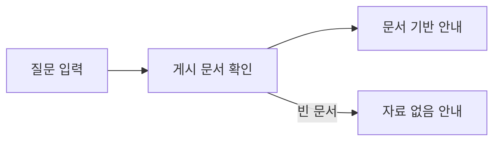

# Sanaebi · 사내비

회사 규정과 업무 절차를 질문하면 회사 문서를 바탕으로 안내하는 사내 지식 도우미입니다. LinkUp 팀은 반복되는 업무 문의를 줄이고 필요한 정보를 쉽게 찾는 서비스를 만듭니다.

**[사내비 바로 사용하기](https://sanaebi.29232923.xyz/chat)**

상시 운영하는 공개 데모입니다. 공용 가상 문서를 사용하며 누구나 익명으로 문서를 편집·게시할 수 있습니다. 문서는 매일 한국시간 자정에 기준 가상 문서로 초기화됩니다. 실제 사내 자료나 개인정보는 입력하지 마세요. [이용 제한·운영 안내](deployment/README.md#공개-시연-제한)

## 사용 모습

채팅 화면에서 궁금한 규정이나 절차를 질문하고 안내를 확인합니다.

<!-- UI 작업 완료 후 이 위치에 채팅 화면 이미지 또는 질문→응답 GIF를 삽입한다.
     보여줄 장면: 질문 입력 → 응답 대기 → 안내 확인.
     촬영 전 실제 동작과 공개 가능한 내용을 확인하고 캡션·대체 텍스트를 작성한다. -->

## 주요 기능

- **규정·절차 안내:** 게시된 회사 문서를 바탕으로 질문에 답합니다.
- **질문에 맞는 안내:** 질문이 불명확하면 구체화를 요청하고 지원 범위 밖의 요청을 안내합니다.
- **문서 관리:** 회사 문서를 등록·편집·게시하고 답변에 사용할 자료를 관리합니다.

## 서비스 흐름



질문 처리 정책과 문서 활용 방식은 [서비스 설계](docs/service-architecture.md)를 참고하세요.

## 현재 구성

| 역할 | 모델 | 적용 상태 | 근거 |
|---|---|---|---|
| 질문 분류 | KoELECTRA base | 선정·서버 적용 | [선정 기록](docs/worklogs/2026-10-15-classifier-selection.md#결정과-근거) |
| 답변 생성 | GPT-6 Luna | 서버·독립 실행 공통 기본값 | [최종 구성](docs/generation-final-prompt.md) |
| 문서 검색 | KURE-v1 | 코드 기본값 `rag`, 질문 게이트·상위20·운영 전환 별도 | [RAG 실행·검증 범위](docs/rag-runtime.md) |

## 로컬 개발 시작

Python 3.12.14·uv, Node.js 22 이상·npm을 사용합니다. 저장소 루트에서 의존성을 설치합니다.

```bash
uv sync --locked
npm ci
npm --prefix web ci
```

최초 1회 DB를 구성하고 기본 문서를 게시합니다. [상세 절차](docs/document-management.md#새-환경의-db-최초-구성)

```bash
uv run --locked python scripts/import_company_knowledge.py \
  --source data/company-knowledge/documents.jsonl --apply --publish-imported
```

로컬에서 실제 답변을 생성하려면 `OPENAI_API_KEY`가 필요하며 API 사용 요금이 발생합니다. [키 설정·답변 준비](app/README.md#문서-기반-답변-확인)

[분류 저장본과 답변 제공자](app/README.md#실행-준비와-api-확인), [RAG 모델·색인·worker](docs/rag-runtime.md#준비와-실행)를 준비한 뒤 웹과 API를 실행합니다. [상세 절차](web/README.md#개발)

```bash
npm run dev
```

브라우저에서 http://127.0.0.1:3000/chat 을 엽니다.

## 더 알아보기

| 내용 | 문서 |
|---|---|
| 서버의 요청 처리와 분류 추론 | [서버 구조](app/README.md) |
| 분류 모델 학습·평가·선정 | [분류 실험](classification/README.md) · [결과](classification/reports/README.md) |
| 최종 Luna 생성·평가와 서버 연결 | [생성 안내](generation/README.md) · [최종 프롬프트](docs/generation-final-prompt.md) |
| 문서 등록·게시 | [문서 관리](docs/document-management.md) |
| 서비스 배포 | [배포](deployment/README.md) |

[전체 문서](docs/README.md)

전체·영역별 회귀 명령은 [테스트 안내](tests/README.md)를 따른다.

소스 실행·선택 의존성의 상세 범위는 [설치 안내](generation/README.md#설치-범위와-선택-provider)를 참고하세요. 현재 서버의 답변 제공자는 OpenAI입니다.

코드 기본 라우팅은 공통 지침과 서버 예측 라벨을 참고 정보로 전달하는 advisory다. 질문·문서가 우선하며 [채택 사유와 원복](docs/worklogs/2026-10-16-adopt-advisory.md)은 품질 개선 입증과 구분한다.
