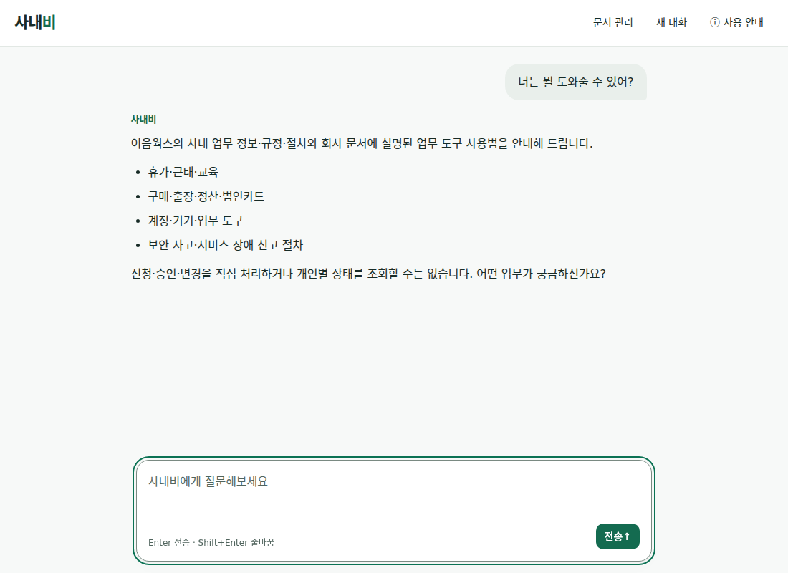
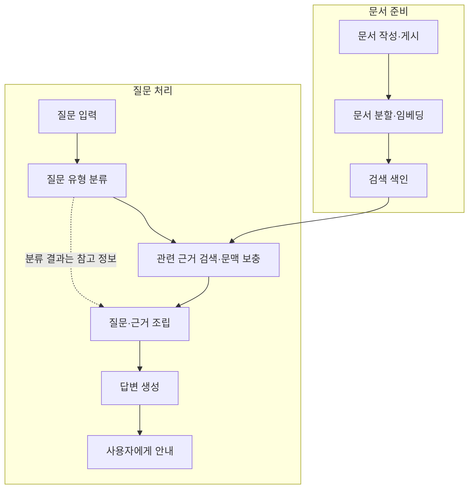

# Sanaebi · 사내비

회사 규정과 업무 절차를 질문하면 게시된 회사 문서를 바탕으로 안내하는 사내 지식 도우미입니다. 어떤 문서를 찾아야 하는지부터 고민하는 대신, 질문으로 필요한 정보를 찾도록 돕습니다. LinkUp 팀이 **가상 회사 ‘이음웍스’를 배경으로 만든 프로젝트**입니다.

**[사내비 바로 사용하기](https://sanaebi.29232923.xyz/chat)**

상시 운영하는 공개 데모입니다. 공용 가상 문서를 사용하며 누구나 익명으로 문서를 편집·게시할 수 있습니다. 문서는 매일 한국시간 자정에 기준 가상 문서로 초기화됩니다. 실제 사내 자료나 개인정보는 입력하지 마세요. [이용 제한·운영 안내](deployment/README.md#공개-시연-제한)

## 사용 모습

<picture>
  <source media="(max-width: 600px)" srcset="docs/assets/readme/chat-mobile.png">
  
</picture>

다음처럼 질문해 보세요.

- “연차 신청 절차를 알려줘.”
- “출장비 정산에 필요한 서류는 뭐야?”
- “보안 사고가 의심되면 어디에 신고해야 해?”

## 주요 기능과 범위

- **규정·절차 안내:** 게시 문서에서 질문과 관련된 근거를 찾아 안내합니다. 필요한 정보가 부족하면 추가 질문이나 확인할 내용을 안내합니다.
- **문서 관리:** [문서 관리 화면](https://sanaebi.29232923.xyz/admin/documents)에서 초안을 저장하고 검토한 뒤 게시합니다. 게시한 문서는 이후 질문의 답변 근거로 사용합니다. 초안 저장만으로는 답변에 반영되지 않습니다.
- **지원 범위:** 신청·승인·예약을 직접 처리하거나 개인의 잔여 연차·신청 상태를 조회하지 않습니다. 문서 안내와 실제 업무 처리는 구분해 주세요.

각 질문은 현재 입력한 내용으로 처리하며 이전 대화를 답변 근거로 사용하지 않습니다. 대화는 서버에 대화 이력으로 저장하지 않으며 새로고침하면 화면의 대화가 사라집니다. 자세한 문서 작성·게시 방법은 [문서 관리 안내](docs/document-management.md)를 참고하세요.

## 서비스 흐름

현재 기본 RAG 경로입니다. 게시 문서를 검색할 수 있도록 준비한 뒤, 질문에 맞는 근거를 찾아 답변을 만듭니다.



분류는 KoELECTRA, 검색은 KURE, 입력 조립은 LangChain, 답변 생성은 Luna가 맡습니다. 기본 경로에서는 분류 라벨로 질문을 차단하지 않으며, 질문과 문서 근거를 우선합니다. 검색 근거가 없어도 그 상태를 생성 단계에 전달해 서비스 범위나 부족한 정보를 안내합니다.

선택 가능한 처리 방식과 오류 경계는 [서비스 설계](docs/service-architecture.md), 색인·검색 실행은 [RAG 안내](docs/rag-runtime.md)를 참고하세요.

## 현재 구성

| 역할 | 기술·모델 | 사용 방식 |
|---|---|---|
| 사용자 화면 | Next.js · TypeScript | 질문·답변과 문서 관리 화면 |
| 요청 처리 | FastAPI | 질문·문서 API와 처리 흐름 연결 |
| 문서 저장 | SQLite | 초안·개정·게시본 관리 |
| 질문 분류 | KoELECTRA base | 질문 유형을 예측해 답변 생성의 참고 정보로 전달. [선정 기록](docs/worklogs/2026-10-15-classifier-selection.md#결정과-근거) |
| 문서 검색 | KURE-v1 | 기본 RAG 경로에서 관련 근거 검색. [실행 기준](docs/rag-runtime.md) |
| 답변 생성 | LangChain · GPT-6 Luna | 질문과 근거를 조립해 안내 생성. [현재 생성 구성](docs/generation-final-prompt.md) |

현재 서버 코드의 기본 문서 공급 방식은 RAG이며 전체 문서 전달(`full`)은 명시적으로 선택하는 경로입니다. 코드 기본값과 실제 배포 확인은 구분하며, 날짜별 운영 확인은 [배포 안내](deployment/README.md)를 참고하세요.

## 데이터와 설계 선택

분류 학습에는 **합성 질문 900개**를 사용했습니다. 답변 근거는 공개 자료를 참고해 LLM으로 작성하고 별도 AI 검수를 거친 **가상 회사 기준 문서 71개**입니다. 두 자료의 용도는 다르며, 서비스에서 사용하는 게시 문서 수는 편집·게시 상태에 따라 달라집니다. 작성·검수·그룹 분할과 한계는 [데이터 안내](data/README.md)에 정리했습니다.

| 단계 | 비교한 관점과 선택 | 상세 근거 |
|---|---|---|
| 분류 | 분류 성능과 CPU 추론 지연을 비교해 KoELECTRA base를 선택했습니다. | [7종 비교](classification/reports/2026-10-15-seven-model-comparison/README.md) |
| 검색 | 필수 근거 포함과 전달량을 비교해 KURE를 채택했습니다. 무관 질문 판별에는 한계가 남아 있습니다. | [KURE 채택](retrieval/reports/2026-10-16-kure-adoption/README.md) |
| 생성 | 전체 문서 입력 조건에서 로컬 Qwen과 Luna의 안내 누락·응답 지연을 비교해 Luna를 선택했습니다. | [생성 모델 선정](generation_evaluation/reports/2026-10-15-model-selection/README.md) |

각 비교의 데이터·입력 조건이 다르므로 점수를 합쳐 현재 RAG 서비스의 종합 정확도로 해석하지 않습니다. 새로운 실제 사용자 질문과 사람 검수를 확대하고, 필수 조건 누락과 근거 충분성 판단을 개선하는 것이 다음 과제입니다.

## 로컬 개발 시작

Python 3.12.14·uv, Node.js 22 이상·npm을 준비합니다. 아래 명령은 Bash 기준입니다.

```bash
git clone https://github.com/KANT-2nd-project/sanaebi.git
cd sanaebi
uv sync --locked
npm ci
npm --prefix web ci
```

**분류 모델은 Git에 포함되지 않으며 현재 공개 다운로드를 제공하지 않습니다.** [모델 준비](app/README.md#모델-준비)에서 권한이 있는 팀원의 저장본 확보 또는 외부 사용자의 재학습 경로 중 하나를 완료하세요. 설치·setup 명령이 분류기를 자동으로 학습하거나 내려받지는 않습니다.

환경 예시를 복사한 뒤 본인의 값을 입력합니다. 기존 `.env`가 있다면 덮어쓰지 말고 필요한 항목만 확인하세요.

```bash
# .env가 아직 없을 때만 복사
cp -n .env.example .env
```

로컬에서 실제 답변을 생성하려면 `OPENAI_API_KEY`가 필요하며 API 사용 요금이 발생합니다. 준비한 분류기가 기본 경로와 다르면 `.env`의 `SANAEBI_CLASSIFIER_PATH`도 지정하세요. [키·모델 설정 상세](app/README.md#실행-준비와-api-확인). 공개 데모 이용에는 키가 필요하지 않습니다.

```bash
npm run setup:local -- --init-documents
npm run check:local
npm run dev
```

첫 setup은 KURE 검색 모델 다운로드와 CPU 색인 계산을 포함할 수 있습니다. DB가 없는 새 환경에만 기준 문서를 등록하며 기존 DB와 의도적으로 전체 삭제한 상태는 보존합니다. 기존 빈 DB에 기준 자료가 필요하면 [기본 문서 복원](docs/document-management.md#문서-전체-관리)을 확인하세요. 로컬 실행에는 공개 데모의 자정 초기화 예약을 자동 설치하지 않습니다.

`check:local`은 준비 상태를 읽어 확인하며 답변 생성이나 품질 평가는 수행하지 않습니다. 문제가 있으면 [준비·진단 절차](docs/rag-runtime.md#준비와-실행)를 확인하세요. `dev`는 API·웹·색인 worker를 함께 실행합니다.

| 로컬 주소 | 용도 |
|---|---|
| http://127.0.0.1:3000/chat | 질문·답변 |
| http://127.0.0.1:3000/admin/documents | 문서 작성·게시 |
| http://127.0.0.1:8000/docs | API 확인. 공개 데모에서는 제공하지 않습니다. |

소스 실행과 선택 의존성은 [설치 안내](generation/README.md#설치-범위와-선택-provider)를 참고하세요. 현재 서버의 생성 제공자는 OpenAI이며, Ollama는 과거 실험·보관 실행의 선택 의존성입니다.

## 팀 소개

| 팀원 | 역할 | GitHub |
|---|---|---|
| 최재선 | 프로젝트 총괄, 데이터·분류, 전반 개발·통합 | [10o0o](https://github.com/10o0o) |
| 유원호 | 생성 모델 비교·답변 평가 | [ho-yu](https://github.com/ho-yu) |
| 윤승환 | FastAPI·요청 응답 처리 | [yshzjq](https://github.com/yshzjq) |
| 전항록 | LangChain 협업·검색·프롬프트·응답 연결 | [Hacilar](https://github.com/Hacilar) |

## 발표자료

[사내비 프로젝트 발표자료](docs/presentation/README.md)

## 더 알아보기

| 목적 | 문서·코드 진입점 |
|---|---|
| 처리 흐름 이해 | [서비스 설계](docs/service-architecture.md) · [서버 구조 `app/`](app/README.md) |
| 데이터와 모델 학습 | [데이터 `data/`](data/README.md) · [분류 `classification/`](classification/README.md) |
| 검색 구현·실험 | [검색 `retrieval/`](retrieval/README.md) · [RAG 실행](docs/rag-runtime.md) |
| 생성과 평가 | [생성 `generation/`](generation/README.md) · [평가 `generation_evaluation/`](generation_evaluation/README.md) |
| 화면·문서 관리 | [웹 `web/`](web/README.md) · [문서 관리](docs/document-management.md) |
| 운영·검증 | [배포 `deployment/`](deployment/README.md) · [테스트 `tests/`](tests/README.md) · [CI 워크플로](.github/workflows/delivery.yml) |
| 이력 탐색 | [전체 문서](docs/README.md) · [보관 분류 구현](archive/classification_v1/README.md) |
