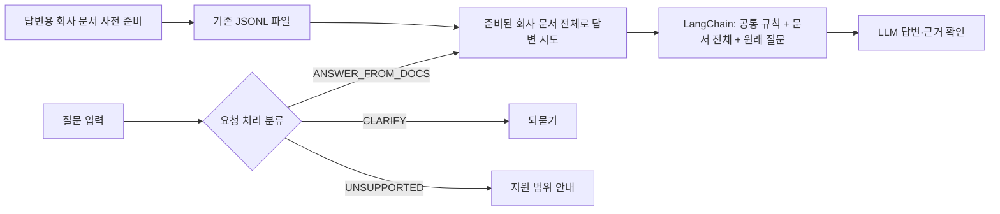

# Sanaebi

LinkUp 팀이 이음웍스 구성원을 위해 준비하는 사내 지식 관리·질의응답 포털입니다. 현재 서비스 구현 상태와 승인된 다음 설계는 [서비스 아키텍처](docs/service-architecture.md)에 정리했습니다.

현재 API 개발 범위는 **`POST /ask`의 질문 처리·답변 연결**입니다. 코드에 있는 두 POST만 명세로 정리하며, `POST /regist-docs`는 초안이 존재하지만 현재 범위 밖인 후속 확장입니다. 답변용 회사 문서는 기존 JSONL 형식으로 별도 준비하며 등록 API의 완성을 기다리지 않습니다.

## 현재 서비스 상태

| 경로·기능 | 현재 동작 | 설계상 다음 단계 |
|---|---|---|
| `POST /ask` | `question` 앞뒤 공백을 제거해 그대로 반환 | 요청 처리 분류와 회사 문서 기반 답변을 연결할 예정 |
| `POST /regist-docs` | `doc` 문자열을 `app/documents.jsonl`에 `{"doc":"본문"}` 한 줄로 추가하는 코드 초안 | 현재 범위 밖. 등록 기능은 후속 확장 |
| LangChain·LLM | 현재 미연결 | 전체 문서·공통 규칙·원래 질문을 전달하는 후속 답변 흐름 |
| 요청 처리 분류 | 현재 미연결. 기존 질문 주제 분류 실험은 별도 | `ANSWER_FROM_DOCS`, `CLARIFY`, `UNSUPPORTED` 중 하나를 반환하는 분류기 1개 |



위 흐름은 설계이며 현재 API 동작이 아닙니다. `ANSWER_FROM_DOCS`는 문서 기반 답변을 시도할 경로를 정할 뿐, 실제 근거가 있다는 뜻은 아닙니다. 문서 확인 후 근거가 없거나 문서끼리 충돌하면 그 상태를 답변에 밝혀야 합니다. 초기에는 RAG를 도입하지 않고 기존 JSONL을 유지합니다. 요청 경계·프롬프트 원칙·공식 자료를 참고한 이유는 [서비스 아키텍처](docs/service-architecture.md), 문서의 6개 주제 라벨은 [분류·라벨링 기준 v2.0](docs/label-taxonomy.md)을 확인하세요.

기존 문서 주제 실험용 [문서 데이터 600건 CSV](data/dataset.csv)를 보존합니다. [데이터 사용 안내](data/README.md)에서 열 설명·분할 지침·검수 상태를, [출처와 이용 조건](data/ATTRIBUTION.md)에서 원문 정보를 확인하세요. 이 자료는 새 요청 처리 분류용 정답이나 실제 이음웍스 규정이 아닙니다.

## 현재 학습 목표

현재 목표는 질문에서 `ANSWER_FROM_DOCS`·`CLARIFY`·`UNSUPPORTED` 중 처리 경로 하나를 선택하는 분류입니다. 새 질문 데이터 작성·사람 검수·모델 학습·서비스 연결은 아직 수행하지 않았습니다. 분류기 개발과 병행해 원래 질문·정답 경로·회사 문서를 전달하여 LangChain 답변을 먼저 평가하고, 실제 분류기를 연결한 전체 흐름은 별도로 평가할 계획입니다.

기존 600건은 문서 라벨 v2.0·데이터셋 v0.2의 7열 CSV이며 `split`이 없습니다. 600건 모두 AI 검수 자료이고 사람 정답 승인 및 이 자료의 모델 학습·평가는 아직 없습니다. 기존 문서 데이터에 대한 시드·원문 계열 분할 지침은 [데이터 안내](data/README.md)에 유지합니다.

`classification/`과 `data/questions/`는 다른 팀원의 기존 질문 주제 분류 실험입니다. 코드·자료·결과를 보존하며, 기존 라벨을 새 요청 처리 라벨로 자동 변환하거나 과거 성능을 새 분류기의 성능으로 사용하지 않습니다.

## 개발 환경

- Python 3.12.14 (`.python-version` 기준)
- uv 0.12.5 이상 권장
- API·기존 분류 실험 의존성은 `pyproject.toml`과 `uv.lock`으로 관리
- 문서 CSV 읽기·기본 검증은 Python 표준 라이브러리만 사용
- Ruff는 개발 도구로만 사용

### Windows PowerShell

uv가 설치되어 있지 않다면 [공식 설치 안내](https://docs.astral.sh/uv/getting-started/installation/)를 따르세요. 이미 설치되어 있으면 다시 설치할 필요가 없습니다.

```powershell
New-Item -ItemType Directory -Force "$HOME\workspace\projects"
Set-Location "$HOME\workspace\projects"
git clone https://github.com/KANT-2nd-project/sanaebi.git
Set-Location .\sanaebi
uv python install 3.12.14
uv sync --locked
```

### WSL

Windows 작업 폴더와 가상환경을 공유하지 말고 WSL 파일시스템에 별도로 clone하고 환경을 만드세요. uv가 없다면 [공식 설치 안내](https://docs.astral.sh/uv/getting-started/installation/)를 따르고, 기존 uv는 재설치하지 않아도 됩니다.

```bash
mkdir -p ~/workspace/projects
cd ~/workspace/projects
git clone https://github.com/KANT-2nd-project/sanaebi.git
cd sanaebi
uv python install 3.12.14
uv sync --locked
```

명령은 가상환경을 직접 활성화하지 않고 `uv run`으로 실행합니다.

## 확인 명령

```bash
uv run --locked python --version
uv run --locked ruff --version
uv lock --check
uv run --locked ruff check .
uv run --locked ruff format --check .
uv run --locked python scripts/validate_dataset.py
uv run --locked python -m unittest discover -s tests -v
```

Windows PowerShell에서의 실행은 별도로 확인하기 전까지 미검증 상태입니다. 데이터 검증은 CSV의 형식·수량·중복을 확인합니다. 원문 계열 분리와 합성 자료의 학습 전용 배치는 후속 학습 코드에서 검증해야 하며, 현재 CSV 검증은 모델 정확도나 서비스 성능 검증을 뜻하지 않습니다.

## 의존성 변경

런타임 의존성은 `uv add <패키지>`, 개발 도구는 `uv add --dev <패키지>`로 추가하고 `pyproject.toml`과 `uv.lock`을 함께 커밋합니다. 잠금 파일은 임의로 편집하지 않습니다.

## 협업과 기록

`main` 브랜치를 함께 사용합니다. 작업 전 최신 내용을 가져오고, 같은 파일을 수정할 때는 먼저 조율합니다. 충돌이나 덮어쓰기 위험이 있으면 임의로 강제 진행하지 말고 팀 리더와 함께 해결합니다.

회의 전에 [개인 일지](https://app.notion.com/p/8a405a3cdadc834ab02001bc72f02534)에 역할, 접근 방법, 실제 수행 내용, 실행·검증 결과, 막힌 점과 다음 할 일, 커밋·실험 링크를 현재 상태에 맞게 적습니다. 팀 문서는 [Notion](https://app.notion.com/p/2bb05a3cdadc82bb813381e3fab45047)에서 확인합니다.
