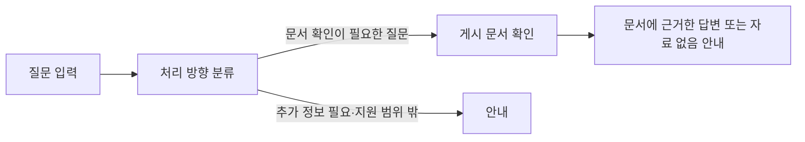

# Sanaebi · 사내비

회사 규정과 업무 절차를 질문하면 회사 문서를 바탕으로 안내하는 사내 지식 도우미입니다. LinkUp 팀은 반복되는 업무 문의를 줄이고 필요한 정보를 쉽게 찾는 서비스를 만듭니다.

## 사용 모습

채팅 화면에서 궁금한 규정이나 절차를 질문하고 안내를 확인합니다.

<!-- UI 작업 완료 후 이 위치에 채팅 화면 이미지 또는 질문→응답 GIF를 삽입한다.
     보여줄 장면: 질문 입력 → 응답 대기 → 안내 확인.
     촬영 전 실제 동작과 공개 가능한 내용을 확인하고 캡션·대체 텍스트를 작성한다. -->

## 주요 기능

- **규정·절차 안내:** 게시된 회사 문서를 바탕으로 질문에 답합니다.
- **질문에 맞는 안내:** 질문이 불명확하면 구체화를 요청하고 지원 범위 밖의 요청을 안내합니다.
- **문서 관리:** 회사 문서를 등록·편집·게시하고 답변에 사용할 자료를 관리합니다.

## 서비스 흐름



[상세 구조](app/README.md)

## 현재 구성

| 역할 | 모델 | 적용 상태 | 근거 |
|---|---|---|---|
| 질문 분류 | KoELECTRA base | 선정·서버 적용 | [선정 기록](docs/worklogs/2026-10-15-classifier-selection.md#결정과-근거) |
| 답변 생성 | Qwen3 4B Instruct 2507 · Ollama | 서버 기본값 | [설정](sanaebi_assistant.py) |

## 빠른 시작

Python 3.12.14·uv, Node.js 22 이상·npm을 사용합니다. 답변을 사용하려면 Git에 포함되지 않은 분류 저장본, 게시 문서, 답변 제공자를 준비합니다. 저장소 루트에서 실행합니다. [상세 절차](web/README.md#개발)

```bash
uv sync --locked
npm ci
npm --prefix web ci
npm run dev
```

브라우저에서 http://127.0.0.1:3000/chat 을 엽니다.

## 더 알아보기

| 내용 | 문서 |
|---|---|
| 서버의 요청 처리와 분류 추론 | [서버 구조](app/README.md) |
| 분류 모델 학습·평가·선정 | [분류 실험](classification/README.md) · [결과](classification/reports/README.md) |
| 생성 모델 실험 | [생성 안내](generation/README.md) |
| 문서 등록·게시 | [문서 관리](docs/document-management.md) |
| 서비스 배포 | [배포](deployment/README.md) |

[전체 문서](docs/README.md)
