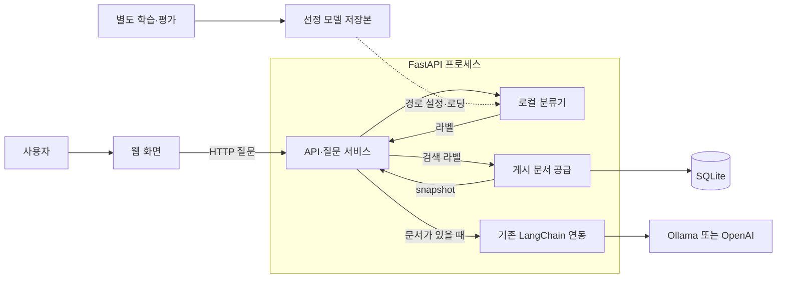

# Sanaebi

사내비는 회사 규정과 업무 절차에 관한 질문을 회사 문서에 근거해 안내하는 LinkUp 팀의 사내 지식 질의응답 프로젝트입니다. 구성원의 반복 문의를 줄이고 필요한 업무 정보를 쉽게 찾도록 돕는 것을 목표로 합니다.

## 전체 구성



웹이 API를 호출하면 서버 내부의 분류기가 처리 방향을 고릅니다. 질문이 불명확하거나 지원 범위 밖이면 고정 안내로 끝납니다. 검색 라벨은 SQLite의 유효 게시본을 읽고 문서가 있을 때 답변을 생성합니다. 분류는 별도 HTTP 서비스가 아니며 학습은 요청 처리 밖에서 실행합니다.

현재 `/ask`에는 선정한 KoELECTRA base와 기존 LangChain 실행기가 연결되어 있습니다. [별도 생성 모듈](generation/README.md)과 [평가 실행](generation_evaluation/README.md)은 서버와 분리된 경로입니다. 모델 선정·서버 연결 검증과 실서비스 답변 품질은 구분하며, 자료 부족·충돌을 적절히 안내하는 품질은 별도 평가 대상입니다. 상세 정책은 [서비스 설계](docs/service-architecture.md)를 따릅니다.

## 빠른 시작

### 준비

Python 3.12.14·uv와 Node.js 22 이상·npm을 사용합니다. 저장소 루트에서 최초 설치합니다.

```bash
uv sync --locked
npm ci
npm --prefix web ci
```

분류를 확인하려면 저장된 모델이 필요합니다. 기본 경로는 `artifacts/experiments/learning-comparison-2026-10-15/koelectra_base/model/`이며 **가중치는 Git에 포함되지 않습니다.** 다른 환경에서는 모델 가중치·config·tokenizer·metadata.json을 함께 준비하고 `SANAEBI_CLASSIFIER_PATH`를 지정하세요. 상대 경로는 저장소 루트 기준입니다.

```bash
# 기본 경로를 사용하지 않을 때만 준비한 모델 폴더 지정
export SANAEBI_CLASSIFIER_PATH=/absolute/path/to/model
```

서버는 로컬 모델만 읽으며 자동 다운로드·학습하지 않습니다. 첫 분류 요청에서 CPU로 로딩하고 재사용하므로 모델 경로·파일을 바꾼 뒤에는 서버를 재시작합니다. 저장본 계약은 [추론 안내](app/classification/README.md), 상세 설정은 [서버 규약](docs/server-conventions.md)을 따릅니다. 아카이브 저장본을 새 서버 경로에 그대로 지정하지 않습니다.

### 실행

```bash
npm run dev
```

웹은 http://127.0.0.1:3000/chat, API는 http://127.0.0.1:8000, API 문서는 http://127.0.0.1:8000/docs 입니다. Ctrl+C로 둘 다 종료하며 한쪽이 종료되면 다른 쪽도 종료합니다. 이 명령은 모델을 학습하거나 Ollama를 시작하지 않습니다.

API만 실행하려면 `npm run dev:api`, 웹만 실행하려면 `npm run dev:web`을 사용합니다. [웹 개발 안내](web/README.md#개발)와 [정적 빌드·nginx 배포 안내](deployment/README.md)에 상세 절차가 있습니다.

### 서버와 분류 확인

다른 터미널에서 순서대로 확인합니다.

```bash
curl http://127.0.0.1:8000/
curl -X POST http://127.0.0.1:8000/classify/koelectra-base \
  -H 'Content-Type: application/json' \
  -d '{"question":"출장비 정산 절차 알려줘"}'
```

`GET /`는 `{"message":"FastAPI 서버가 실행 중입니다."}`로 HTTP 실행을 확인합니다. 모델 로딩 확인은 두 번째 요청입니다. 분류 응답은 `{"category":"UNSUPPORTED"}` 형태이며 실제 라벨은 모델 결과에 따라 달라집니다. 질문별 문서 조회·LLM 호출 없이 분류만 확인하지만, 서버 시작 시에는 SQLite 저장소를 초기화합니다.

모델 부재·잘못된 저장본·추론 실패는 503과 `분류 모델을 사용할 수 없습니다.`라는 오류 안내를 반환합니다. 모델을 준비하지 않았다면 서버 응답 확인까지만 가능하며, 분류 성공으로 간주하지 않습니다.

### 문서 기반 답변 확인

검색 라벨의 실제 답변에는 게시된 회사 문서와 생성 제공자 준비가 추가로 필요합니다. 새 환경에서 기존 회사 지식 71건을 사용하려면 [문서 이관 안내](docs/document-management.md#회사-지식-이관내보내기)의 dry-run 후 명시적으로 적용·게시합니다. 이후 문서는 `/admin/documents`에서 편집·게시하며 재시작 시 자동 이관하지 않습니다. 게시는 사람 검수 승인을 의미하지 않습니다.

`SANAEBI_ANSWER_PROVIDER`는 `ollama`(기본) 또는 `openai`입니다. Ollama는 실행 중인 서버와 모델이, OpenAI는 `OPENAI_API_KEY`가 필요하며 API 비용이 발생합니다. 필요한 환경변수는 실행 프로세스에 전달합니다. 위 명령이 `.env`를 자동으로 읽는다고 가정하지 않습니다. 실제 생성 모델의 입력 한도와 문서 준비를 확인한 뒤 호출하세요.

```bash
curl -X POST http://127.0.0.1:8000/ask \
  -H 'Content-Type: application/json' \
  -d '{"question":"휴가 신청 방법 알려줘"}'
```

성공 응답은 `{"ok":true,"text":"안내 또는 생성된 답변","reason":""}` 형태입니다. CLARIFY·UNSUPPORTED는 고정 안내, SEARCH_KNOWLEDGE라도 문서가 없으면 자료 없음 안내를 반환합니다. 생성 실패는 502이며 빈 문서의 정상 안내와 다릅니다. 이 요청은 준비 상태 확인 예시이며 실제 답변 품질 검증을 대신하지 않습니다.

## 목적별 문서

| 하려는 일 | 시작할 문서 |
|---|---|
| 서버 요청이 어떻게 연결되는지 이해 | [서버 요청 흐름](app/README.md) → [분류기 추론](app/classification/README.md) |
| 분류 모델을 학습·평가 | [학습 코드 안내](classification/README.md) |
| 비교 결과·모델 선정 근거 확인 | [분류 실험 보고서](classification/reports/README.md) |
| 문서를 등록·게시·이관 | [문서 관리](docs/document-management.md) |
| 생성 모듈과 별도 평가 실험 | [생성 모듈](generation/README.md) · [평가 실행](generation_evaluation/README.md) |
| 웹 개발·배포 | [웹 안내](web/README.md) · [배포 안내](deployment/README.md) |
| 정책·데이터·과거 기록 탐색 | [문서 색인](docs/README.md) |
| 문서 작성·Notion 동기화 | [문서 관리 가이드](docs/documentation-guide.md) · [팀 문서](https://www.notion.so/2bb05a3cdadc82bb813381e3fab45047) |

## 개발 확인

저장소 루트에서 실행합니다. 작업 규칙은 [AGENTS.md](AGENTS.md)를 따릅니다.

```bash
uv lock --check
uv run --locked ruff check .
uv run --locked ruff format --check .
uv run --locked python scripts/validate_dataset.py
uv run --locked python -m unittest discover -s tests -v
```

데이터 검증은 현재 요청 처리 데이터와 검수 기록을 확인합니다. 모델 성능이나 실제 서비스 답변 품질을 측정하지는 않습니다. 문서만 수정한 경우에는 링크·설명·예제·렌더링을 우선 확인하고 수행한 검사와 실행하지 않은 검사를 구분해 기록합니다.
