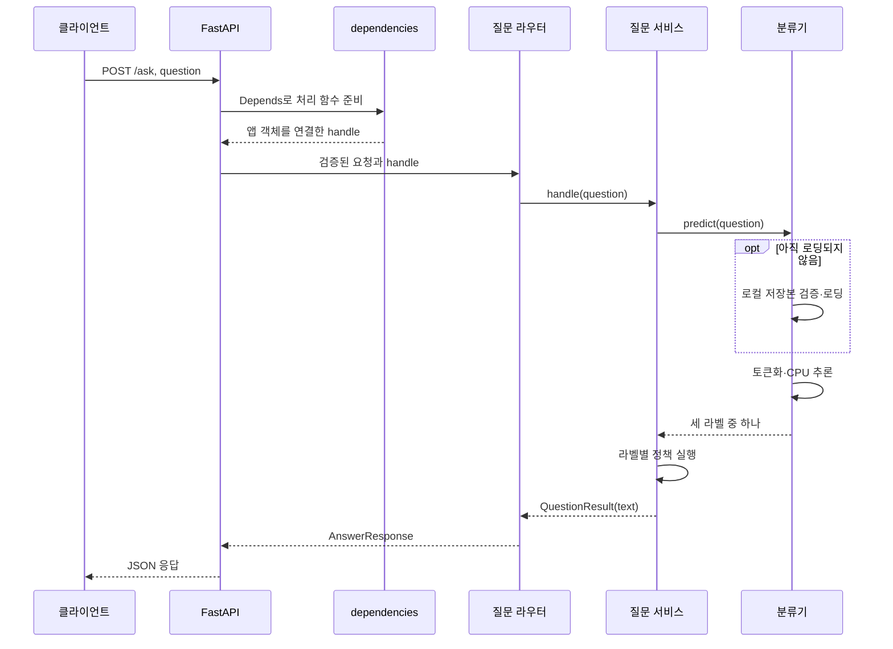

# 서버 요청 흐름 읽기

서버는 질문을 받아 처리 방향을 분류하고, 필요한 경우 게시된 회사 문서로 답변을 생성한다. 분류기는 FastAPI 프로세스 안에서 실행하며 별도 HTTP 서버가 아니다. 서비스 소개와 공통 설치는 [프로젝트 README](../README.md#빠른-시작)를, 서버 준비와 API 확인은 아래 절차를 따른다.

## 실행 준비와 API 확인

### 모델 준비

분류를 확인하려면 저장된 모델이 필요합니다. 기본 경로는 `artifacts/experiments/learning-comparison-2026-10-15/koelectra_base/model/`이며 **가중치는 Git에 포함되지 않습니다.** 다른 환경에서는 모델 가중치·config·tokenizer·metadata.json을 함께 준비하고 `SANAEBI_CLASSIFIER_PATH`를 지정하세요. 상대 경로는 저장소 루트 기준입니다.

```bash
# 기본 경로를 사용하지 않을 때만 준비한 모델 폴더 지정
export SANAEBI_CLASSIFIER_PATH=/absolute/path/to/model
```

서버는 로컬 모델만 읽으며 자동 다운로드·학습하지 않습니다. 첫 분류 요청에서 CPU로 로딩하고 재사용하므로 모델 경로·파일을 바꾼 뒤에는 서버를 재시작합니다. 저장본 계약은 [추론 안내](classification/README.md), 상세 설정은 [서버 규약](../docs/server-conventions.md)을 따릅니다. 아카이브 저장본을 새 서버 경로에 그대로 지정하지 않습니다.

### 서버 실행과 연결 확인

[공통 설치](../README.md#빠른-시작)를 마친 뒤 저장소 루트에서 실행한다.

```bash
npm run dev:api
```

API는 http://127.0.0.1:8000, API 문서는 http://127.0.0.1:8000/docs 에서 확인한다. 웹과 함께 실행하려면 [웹 실행 절차](../web/README.md#개발)를 따른다.

다른 터미널에서 순서대로 확인합니다.

```bash
curl http://127.0.0.1:8000/
curl -X POST http://127.0.0.1:8000/classify/koelectra-base \
  -H 'Content-Type: application/json' \
  -d '{"question":"출장비 정산 절차 알려줘"}'
```

`GET /`는 `{"message":"FastAPI 서버가 실행 중입니다."}`로 HTTP 실행을 확인합니다. 모델 로딩 확인은 두 번째 요청입니다. 분류 응답은 `{"category":"UNSUPPORTED"}` 형태이며 실제 라벨은 모델 결과에 따라 달라집니다. 질문별 문서 조회·LLM 호출 없이 분류만 확인하지만, 서버 시작 시에는 SQLite 저장소를 초기화합니다.

모델 부재·잘못된 저장본·추론 실패는 503과 `분류 모델을 사용할 수 없습니다.`라는 오류 안내를 반환합니다. 모델을 준비하지 않았다면 서버 응답 확인까지만 가능하며, 분류 성공으로 간주하지 않습니다.

### 문서 기반 답변 확인

검색 라벨의 실제 답변에는 게시된 회사 문서와 생성 제공자 준비가 추가로 필요합니다. 새 환경에서 기존 회사 지식 71건을 사용하려면 [DB 초기 구성](../docs/document-management.md#새-환경의-db-최초-구성)의 dry-run 후 명시적으로 적용·게시합니다. 이후 문서는 `/admin/documents`에서 편집·게시하며 재시작 시 자동 이관하지 않습니다. 게시는 사람 검수 승인을 의미하지 않습니다.

`SANAEBI_ANSWER_PROVIDER`는 `ollama`(기본) 또는 `openai`입니다. Ollama는 실행 중인 서버와 모델이, OpenAI는 `OPENAI_API_KEY`가 필요하며 API 비용이 발생합니다. 필요한 환경변수는 실행 프로세스에 전달합니다. 위 명령이 `.env`를 자동으로 읽는다고 가정하지 않습니다. 실제 생성 모델의 입력 한도와 문서 준비를 확인한 뒤 호출하세요.

```bash
curl -X POST http://127.0.0.1:8000/ask \
  -H 'Content-Type: application/json' \
  -d '{"question":"휴가 신청 방법 알려줘"}'
```

성공 응답은 `{"ok":true,"text":"안내 또는 생성된 답변","reason":""}` 형태입니다. CLARIFY·UNSUPPORTED는 고정 안내, SEARCH_KNOWLEDGE라도 문서가 없으면 자료 없음 안내를 반환합니다. 생성 실패는 502이며 빈 문서의 정상 안내와 다릅니다. 이 요청은 준비 상태 확인 예시이며 실제 답변 품질 검증을 대신하지 않습니다.

## 서버 시작과 첫 요청

[fastapi_main.py](fastapi_main.py)의 `lifespan`은 SQLite 저장소를 초기화하고 문서 provider·분류기 객체·답변 제공자 설정을 `app.state`에 준비한다. 모델 가중치는 첫 `predict()`에서 읽는다. `GET /` 성공은 서버 응답 확인이며 모델 로딩 성공을 증명하지 않는다.



FastAPI가 의존성을 해결한 뒤 라우터 본문을 호출한다. 라우터가 DI 함수를 직접 호출하는 것은 아니다. 모델 로딩에 실패하면 정상 라벨 반환 대신 오류 경로로 종료한다. 성공한 모델은 앱 프로세스에서 재사용하며 여러 worker는 각각 별도 모델을 갖는다.

## 질문 한 건이 지나가는 경계

예를 들어 `{"question":"연차 신청 절차 알려줘"}`를 보내면 요청 스키마가 입력을 검사하고 라우터가 앞뒤 공백을 제거해 처리 함수에 전달한다. 이 문장의 실제 라벨은 모델 예측 결과에 따라 정해진다.

| 경계 | 입력 → 출력 | 책임 |
|---|---|---|
| [questions/router.py](questions/router.py) | QuestionRequest → AnswerResponse | HTTP 입력 전달·응답 변환 |
| [dependencies.py](dependencies.py) | 앱 객체 → 질문 처리 함수 | 분류·문서·답변 함수 조립 |
| [questions/service.py](questions/service.py) | 질문과 세 함수 → QuestionResult | 라벨별 호출 순서 결정 |
| [classification/predictor.py](classification/predictor.py) | 문자열 → ClassificationLabel | 저장 모델 추론 |
| [documents/context.py](documents/context.py) | snapshot() → DocumentContextSnapshot | 유효한 게시 문서 확보 |
| [answering/adapter.py](answering/adapter.py) | 질문·snapshot·provider → 문자열 | 기존 실행기 호출·답변 검증 |

### 의존성 조립은 무엇인가

`get_question_handler()`는 `partial()`로 서비스에 세 함수를 미리 연결한다. 아래는 이해를 돕는 동등한 형태이며 실제 코드는 [dependencies.py](dependencies.py)에 있다.

```python
# 개념 예제: 구현을 미리 연결하고 요청마다 question만 받는다.
def handle(question):
    return handle_question(
        question,
        classify=classifier.predict,
        read_documents=document_provider.snapshot,
        answer=selected_answer_function,
    )
```

서비스는 모델 경로나 DB 접속 방법을 몰라도 된다. 테스트에서는 이 함수들을 대체해 모델·LLM 없이 정책을 확인한다. 구현 선택은 조립 계층, 처리 순서는 서비스가 맡는다.

### 라벨에 따라 호출이 달라진다

| 분류·자료 상태 | 반환할 내용 | 요청 중 문서 조회 | 답변 생성 호출 |
|---|---|---:|---:|
| CLARIFY | 질문 구체화 안내 | 없음 | 없음 |
| UNSUPPORTED | 지원 범위 안내 | 없음 | 없음 |
| SEARCH_KNOWLEDGE, 문서 없음 | 자료 없음 안내 | 1회 | 없음 |
| SEARCH_KNOWLEDGE, 문서 있음 | 생성한 답변 | 1회 | 있음 |

라벨은 처리 방향이며 근거 존재를 보장하지 않는다. 허용되지 않은 라벨은 프로그래밍 오류로 처리한다. 비검색 요청에서 문서를 조회하지 않는다는 것은 서버 시작 시 SQLite 초기화도 없다는 뜻은 아니다. 상세 정책과 목표 설계는 [서비스 아키텍처](../docs/service-architecture.md)를 따른다.

### 문서는 한 번 확보해서 전달한다

`DocumentContextProvider.snapshot()`은 SQLite의 유효한 게시본을 읽는다. snapshot에는 본문 외에 문서 ID·개정·제목·출처·메타데이터가 함께 있다. 서비스는 같은 snapshot을 답변기에 전달하고 어댑터는 DB를 다시 읽지 않는다. 현재 이 단계는 게시 문서 공급이며 질문 유사도 기반 벡터 검색은 아니다.

답변 어댑터는 전달받은 질문과 snapshot으로 기존 `sanaebi_assistant.py` 실행기의 선택한 제공자를 호출한다. 실행 성공 여부와 답변 본문을 검증한 뒤 문자열을 반환한다. 별도 `generation/`은 현재 이 서버 경로에 연결되지 않았다. 이후 생성기를 구성할 때도 `질문 + snapshot → 답변 문자열` 경계를 유지하면 서비스 변경을 줄일 수 있다.

## API별 차이와 오류

| API | 사용 목적 |
|---|---|
| `POST /ask` | 분류 → 서비스 정책 → 필요한 경우 문서·답변 생성. `ok`, `text`, `reason` 반환 |
| `POST /classify/koelectra-base` | `/ask`와 같은 분류 객체로 라벨만 확인. `category` 반환 |
| `POST /assistant` | 이미 분류한 `response`·`classification_label`을 기존 실행기에 전달. `/ask` 서비스 경로와 출력 계약이 다름 |

`/ask/langchain`은 없다. `/ask` 성공의 `text`는 고정 안내 또는 생성 답변이며 `reason`은 빈 문자열이다. 입력 검증은 422, 분류 모델·문서 공급 장애는 503, 답변 생성·본문 검증 실패는 502다. 빈 문서의 정상 안내와 저장소 장애를 구분한다. 상세 설정·오류·문서 관리 API 계약은 [서버 규약](../docs/server-conventions.md)과 [문서 관리](../docs/document-management.md)를 따른다.

## 코드 읽는 순서와 진단

1. [진입점](fastapi_main.py): 시작 시 객체와 HTTP 기능 등록.
2. [질문 라우터](questions/router.py) → [의존성](dependencies.py): 요청과 처리 함수 연결.
3. [질문 서비스](questions/service.py): 세 라벨의 처리 순서.
4. [분류기 설명](classification/README.md): 토큰화·점수·라벨 해석.
5. [문서 snapshot](documents/context.py) → [답변 어댑터](answering/adapter.py): 검색 경로의 입력과 출력.

문서 공급 상태는 저장소 루트에서 다음 명령으로 확인한다. 기존 SQLite 게시본의 문서 수와 snapshot 식별값을 읽으며 DB를 생성하거나 변경하지 않는다. DB가 없거나 사용할 수 없으면 오류를 표시한다.

```bash
uv run --locked python -m scripts.inspect_document_context
```

[진단 trace](diagnostics/trace.py)는 선택적 요청·LangChain 기록이다. `TRACE_DIR`을 지정했을 때 기록하며 `TRACE_MAX_CHARS`·`TRACE_FULL_PROMPT`로 기록 길이를 조절한다. 상세 기록 형식은 해당 모듈의 설명을, 변경 기준은 [서버 규약](../docs/server-conventions.md)을 따른다. 문서를 수정하거나 이관하려면 [문서 관리 절차](../docs/document-management.md)를, 전체 문서 탐색은 [문서 색인](../docs/README.md)을 이용한다.

## 개발 검사

저장소 루트에서 수행한다. 문서 변경은 링크·설명·렌더링을 확인하며 모델 테스트를 다시 실행한 것으로 기록하지 않는다. 코드 변경에 필요한 회귀 범위는 [서버 규약](../docs/server-conventions.md)을 따른다.

```bash
uv lock --check
uv run --locked ruff check .
uv run --locked ruff format --check .
uv run --locked python scripts/validate_dataset.py
uv run --locked python -m unittest discover -s tests -v
```
