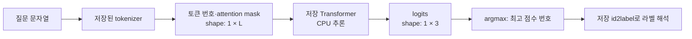

# 서버 분류기 추론

이 폴더는 준비된 Transformer 저장본으로 질문 하나를 분류하는 서버 기능이다. 루트의 [classification/](../../classification/README.md)은 데이터·학습·선택·평가 공간이다. 학습 명령은 서버 설정을 자동으로 바꾸지 않으며 서버는 별도로 선정한 저장본을 읽는다. 전체 호출 관계는 [서버 요청 흐름](../README.md)에서 시작한다.

## 질문이 라벨이 되는 과정

[predictor.py](predictor.py)의 외부 계약은 `TransformerClassifier(model_path)`와 `predict(question) → ClassificationLabel`이다. 분류 결과는 `SEARCH_KNOWLEDGE`, `CLARIFY`, `UNSUPPORTED` 중 하나이며 이후 처리 여부는 질문 서비스가 결정한다.



질문 앞뒤 공백을 제거하고 tokenizer가 `input_ids`와 `attention_mask`를 만든다. 한 문항이므로 `[1, L]`이고 `L`은 특수 토큰을 포함한 토큰 길이다. 저장된 최대 길이까지 절단하며 단건 입력에는 padding을 하지 않는다. token type IDs는 요청하지 않는다.

모델의 출력은 세 라벨 점수인 `[1, 3]` logits다. 예를 들어 **가상의** 점수가 `[[0.4, 2.1, -0.7]]`이면 `argmax`는 `1`을 고른다. 최종 라벨은 `model.config.id2label[1]`에서 읽는다. 번호 1이 항상 특정 라벨이라는 가정은 하지 않는다. logits는 확률이 아니며 이 예제는 실제 예측 결과가 아니다.

## 첫 로딩과 재사용

1. 앱 시작에는 경로·잠금을 가진 추론 객체만 만든다.
2. 첫 `predict()`가 잠금을 잡고 메타데이터·로컬 파일을 확인한 뒤 tokenizer와 모델을 로딩한다.
3. 모델은 CPU에 두고 `eval()`로 전환한다. 추론은 `torch.inference_mode()`로 수행한다.
4. 점수의 shape와 유한성을 검사하고 저장된 라벨 매핑으로 반환한다.
5. 이후 요청은 성공적으로 로딩한 객체를 재사용한다. 로딩에 실패하면 다음 요청에서 다시 시도한다.

잠금은 초기화와 추론 전체에 적용되어 동시 호출을 직렬화한다. `/ask`와 분류 전용 API는 [공통 의존성](../dependencies.py)에서 같은 앱 객체를 받는다. 여러 worker는 모델을 각각 로딩하므로 메모리를 공유하지 않는다. 실행 중 파일을 바꿔도 이미 로딩한 모델은 교체되지 않으며 서버 재시작이 필요하다.

## 저장본 계약

서버는 `local_files_only=True`로 로컬 파일만 읽으며 다운로드·학습·아카이브 변환을 하지 않는다. 필수 검사 대상은 `metadata.json`, `config.json`, `model.safetensors`이며 **tokenizer 로딩에 필요한 저장 파일도 함께** 준비해야 한다.

| 확인 항목 | 현재 검사 |
|---|---|
| 메타데이터 | 객체 형식, `schema_version=1`, 비어 있지 않은 `model_id` |
| 라벨 | `labels`가 공통 세 라벨과 일치하는 중복 없는 목록 |
| 길이 | `config.max_length`가 양의 정수이고 모델 위치 임베딩 한도 이하 |
| 모델 config | 출력 개수 3, `id2label`·`label2id`가 메타데이터 라벨 순서와 일치 |
| 추론 출력 | `[1, 3]` shape이며 NaN·무한대가 없음 |

`model_id`는 모델 묶음의 식별자이며 무결성 인증이 아니다. 전체 가중치 해시를 매 요청 계산하지 않는다. 이 메타데이터 버전은 [아카이브](../../archive/classification_v1/README.md)의 manifest 버전과 다른 계약이다.

## 설정·교체·실패 경계

현재 선정본은 KoELECTRA base다. 선정 이유와 과거 실측은 [분류 보고서 목록](../../classification/reports/README.md)에서 확인하며 이 문서에 성능표를 복제하지 않는다.

모델 경로는 `SANAEBI_CLASSIFIER_PATH`로 지정한다. 기본 경로·상대 경로 해석과 교체 검증 기준은 [서버 규약의 모델 설정](../../docs/server-conventions.md#모델-설정과-수명주기)을 따른다. 같은 저장 형식·메타데이터·라벨 계약을 만족하는 Transformer를 경로로 주입할 수 있으며 TF-IDF나 모든 아카이브 저장본을 지원하는 범용 로더는 아니다.

교체할 때는 저장본 준비 → 라벨·예측 회귀 검증 → 경로 설정 → 서버 재시작 → 분류 API 확인 순서로 진행한다. 서버 준비·HTTP 요청 예시는 [서버 실행 안내](../README.md#실행-준비와-api-확인)에 있다. 가중치는 Git에 없으며 학습이나 자동 다운로드를 서버 실행의 일부로 취급하지 않는다.

파일·메타데이터·라벨 매핑 문제는 `ClassificationUnavailable`, 로딩 후 추론 실패는 `ClassificationInferenceError`로 구분한다. [오류 핸들러](../errors.py)는 두 오류를 안전한 503 응답으로 변환하고 내부 경로·원문 예외를 노출하지 않는다. 일반 프로그래밍 오류까지 모델 부재로 설명하지 않는다.

기존 선정 checkpoint의 연결 검증은 [서버 연결 기록](../../docs/worklogs/2026-10-15-server-classifier-integration.md)에 있다. 모델 선정·서버 예측 일치·실서비스 답변 품질은 서로 다른 검증이다. 학습 방법은 [학습 안내](../../classification/README.md), 정책은 [라벨 기준](../../docs/label-taxonomy.md)을 이어서 읽는다.

## 분류기만 직접 확인하기

[모델 준비](../README.md#모델-준비)를 마친 뒤 저장소 루트에서 실행한다. 서버와 SQLite를 시작하지 않고 같은 추론 클래스를 직접 호출한다. 모델 로딩·CPU 추론은 실제로 실행하므로 준비된 로컬 저장본이 필요하다.

```bash
uv run --locked python - <<'PYTHON'
from app.classification.predictor import TransformerClassifier
from app.settings import get_classifier_path

classifier = TransformerClassifier(get_classifier_path())
print(classifier.predict("휴가 신청 방법 알려줘"))
PYTHON
```

출력은 세 라벨 중 하나이며 이 예문에 대한 정답이나 성공 결과를 미리 확정하지 않는다. 이 절차는 학습·문서 조회·LLM 호출을 하지 않는다. HTTP 연결과 오류 응답까지 확인하려면 [서버 API 확인](../README.md#서버-실행과-연결-확인)을 사용한다. 모델 비교와 선정 근거는 [실험 보고서](../../classification/reports/README.md)에 둔다.
