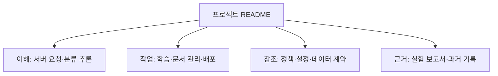

# 문서 찾아보기

[프로젝트 README](../README.md)는 서비스 목적·사용 모습·현재 구성과 공통 시작을 소개하는 진입점이다. 이 색인은 목적별 상세 문서를 안내한다. 서버 코드를 이해하려면 [서버 요청 흐름](../app/README.md)으로 바로 이동해도 된다.

**[사내비 바로 사용하기](https://sanaebi.29232923.xyz/chat)** — 공용 문서·자정 초기화 등 이용 조건은 [배포 안내](../deployment/README.md#공개-시연-제한)를 따른다.

## 이해하기

| 문서 | 읽는 목적 |
|---|---|
| [서버 요청 흐름](../app/README.md) | 시작·의존성 조립·질문 한 건의 처리 |
| [서버 분류기 추론](../app/classification/README.md) | 토큰화·점수·라벨, 저장본 로딩과 재사용 |
| [서비스 아키텍처](service-architecture.md) | 현재 처리 정책과 후속 설계의 경계 |
| [프런트엔드 설계](frontend-architecture.md) | 화면·API 중계·정적 내보내기 |

## 작업하기

| 문서 | 작업 |
|---|---|
| [로컬 개발 시작](../README.md#로컬-개발-시작) | 설치·통합 실행 |
| [서버 준비·API 확인](../app/README.md#실행-준비와-api-확인) | 모델·문서·제공자 준비, HTTP 확인과 선택적 답변 요청 |
| [분류기 독립 확인](../app/classification/README.md#분류기만-직접-확인하기) | HTTP·문서 저장소 없이 로컬 저장본 추론 |
| [분류 학습](../classification/README.md) | 데이터·그룹 분할·TF-IDF·Transformer 학습과 명시적 평가 |
| [문서 관리](document-management.md) | 등록·개정·게시·사용 중단·이관·내보내기 |
| [생성 모듈](../generation/README.md) · [별도 평가 실행](../generation_evaluation/README.md) | 서버와 공통 생성 모듈·독립 평가 |
| [웹 개발](../web/README.md) · [배포](../deployment/README.md) | 프런트 개발·정적 빌드·nginx 구성 |

## 계약과 기준 찾기

| 문서 | 기준 위치 |
|---|---|
| [서버 규약](server-conventions.md) | 책임·내부 계약·설정·오류·회귀 검증 |
| [라벨 기준](label-taxonomy.md) | 세 처리 라벨의 의미와 경계 사례 |
| [데이터 안내](../data/README.md) | 분류 데이터와 답변용 회사 지식의 용도·검수·분할 |
| [생성 평가 기준](generation-evaluation.md) | 응답 검사와 품질 평가 기준 |
| [최종 생성 프롬프트](generation-final-prompt.md) · [실행 설정](generation-runtime.md) | 서버·독립 생성·평가의 Luna 기본 구성 |
| [문서 관리 가이드](documentation-guide.md) | 사실의 기준 위치·Notion 대응·작성 절차 |

## 결과와 과거 기록

| 문서 | 시간·용도 구분 |
|---|---|
| [문서 검색·임베딩 보고서](../retrieval/reports/2026-10-15-cpu-embedding-comparison/README.md) | 16종 CPU 비교와 KoEn-E5-Tiny 선정 당시 기록 |
| [분류 보고서 목록](../classification/reports/README.md) | 현재 학습 코드의 비교·선정 판단과 근거 |
| [Luna 서버 통합 기록](worklogs/2026-10-15-server-generation-integration.md) | 공통 생성 경로·API 통일·검증과 한계 |
| [서버 연결 기록](worklogs/2026-10-15-server-classifier-integration.md) | 선정 checkpoint 연결·당시 검증 결과 |
| [서버 구조 정리 기록](worklogs/2026-10-15-server-feature-layout.md) | 기능별 재배치·호환·당시 검증 |
| [작업 기록 폴더](worklogs/) | 작업별 변경·실행·검증 경위. 현재 사용법은 해당 기준 문서 확인 |
| [기존 분류 구현](../archive/classification_v1/README.md) · [과거 실험 보고서](../archive/classification_v1/reports/README.md) | 보존된 sanaebi CLI·MLflow·과거 저장 형식과 결과 |
| [과거 문서 주제 분류](../data/archive/document-topics-v0.2/README.md) · [과거 질문 주제 분류](../data/archive/question-topics/README.md) | 현재 처리 라벨과 구별되는 이전 자료 |

과거 결과를 현재 실행 결과로 옮겨 쓰지 않는다. 학습·모델 선정·서버 연결·실서비스 품질은 별도로 확인한다. 실행 원자료와 가중치의 로컬 위치는 각 보고서에 있으며 공개 다운로드 링크가 아니다.

- [답변 출처 표시·문서 충실성 검증](../generation_evaluation/reports/2026-10-15-answer-grounding/README.md): v2 후보의 실제82회 비교, 기본값 미승격과 남은 한계.

- [v3 최소 프롬프트 변경 검증](../generation_evaluation/reports/2026-10-15-answer-grounding-v3/README.md): 두 규칙 추가·초기24회 비교, 신고 정보 누락에 따른 확대 평가·승격 보류.

- [v1·v3 반복 비교](../generation_evaluation/reports/2026-10-15-answer-grounding-repeat/README.md): 각25회·사용자 요청 중단, 소표본 해석 재검토와 기준 민감도.

- [v3 기본값 채택·전환 검증](worklogs/2026-10-15-adopt-grounding-v3.md): 반복 결과를 확인한 사용자 결정, 공통 기본값 전환과 검증.

- [핵심 코드 정리·완료 상태·후속 작업](worklogs/2026-10-15-core-cleanup.md): 구형 추출 제거, 프로필 필수화, legacy 이동과 단계별 인수인계.

- [S4 평가 전략·지원 코드 정리](worklogs/2026-10-15-evaluation-cleanup.md): 동작 보존 검증과 남은 단계.

- [S5·S6 남은 코드 정리](worklogs/2026-10-15-remaining-cleanup.md): 선택 설치·검증 모듈·테스트 배치와 완료 상태.

## 분류 관찰 모드 비교

- [40문항 종단 비교·권고](../generation_evaluation/reports/2026-10-15-routing-shadow/README.md): gate/shadow의 두 반복 응답·AI 판정·실패·비용·지연.
- [shadow main 통합](worklogs/2026-10-15-merge-shadow-main.md): v3·최신 코드 정리 보존, 통합 회귀와 게시.
- [shadow 기본값 채택](worklogs/2026-10-15-adopt-shadow.md): 비교 후 사용자 결정, 미달 기준과 원복 설정.
- [구현·검증·게시 기록](worklogs/2026-10-15-routing-shadow.md): AI 수행 범위, 기능별 커밋, 테스트와 Notion 동기화.

- [사용자용 말투·범위 안내 보완](worklogs/2026-10-15-user-facing-prompt.md): 연봉·도움 범위·일반 기술 질문, 공식 레퍼런스와 독립 AI 검토·실제 비교.

- [RAG 실행·색인 갱신·자정 벡터 복구](rag-runtime.md): 로컬 준비와 서버 검색 계약.

RAG 로컬 구현의 범위·검증·미검증 항목은 [구현 기록](worklogs/2026-10-15-rag-local-integration.md)에서 확인한다.

- [답변 가독성 v5/v6 비교](../generation_evaluation/reports/2026-10-15-readability-v6/README.md): 16회 실제 응답·익명 AI 판정·화면 검증과 v5 기본값 유지 결정. [작업 일지](worklogs/2026-10-15-readability-v6.md).

## 분류 라벨 보조 전달 평가

기존 프롬프트·지침만 추가·실제 라벨 전달·대체 라벨 비교의 원응답, 판정과 미채택 근거. [평가 결과](../generation_evaluation/reports/2026-10-15-classification-advisory/README.md)에서 분모·비용·한계를 확인할 수 있다.

- [RAG 단계별 검색 품질 비교](../retrieval/reports/2026-10-15-rag-quality-improvement/README.md): 기존 검색 유지 결정과 인접 확장의 관측 개선·미채택 근거. [구현·게시 기록](worklogs/2026-10-15-rag-quality-improvement.md).

- [Full·RAG 실제 답변 비교와 문서 초기화 연동](../retrieval/reports/2026-10-15-rag-answer-comparison/README.md): 형식 오류에 따른 중단·승격 보류와 격리 검증.
- [전체 프롬프트 v7 독립 보강108회 비교](../generation_evaluation/reports/2026-10-15-prompt-v7/README.md): 가독성·완전성 분리,3회 반복과 v5 유지, 재부팅 뒤 증거 복구·미복구 범위. [일지](worklogs/2026-10-15-prompt-v7.md).

- [RAG 평가 기준 보완·검색 최적화](../retrieval/reports/2026-10-15-retrieval-v3/README.md): qrel v3·CPU 비교와 신규 확인 후 C 유지.
- [RAG C 채택·인자 및 문맥 비교](../retrieval/reports/2026-10-15-c-adoption/README.md): 검색 근거 누락 최소화에 따른 사용자 선택, rag 코드 기본값과 운영 미전환 구분.

[KURE 검색 전환 검증](../retrieval/reports/2026-10-16-kure-gate/README.md): 당시 소규모 비교·질문 게이트 검증·보류 기록. 이후 사용자 결정에 따른 [KURE 채택·서버 연결](../retrieval/reports/2026-10-16-kure-adoption/README.md)을 함께 본다.

[분류 참고 정보 C 후속 채택](worklogs/2026-10-16-adopt-advisory.md): 공통 지침+서버 라벨 advisory 기본값, 평가 결과와 사용자 설계 결정, 검증·원복·게시 기록.
