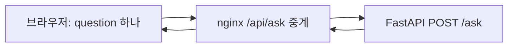

# 프런트엔드 설계와 구현 순서

- 기준일: 2026-10-14
- 상태: 정적 내보내기·FastAPI 중계·메모리 기반 대화형 화면·SQLite 문서 관리 UI를 구현했다. 초기 echo 검증은 과거 기록이며 현재 /ask는 분류 후 답변 경로를 호출한다. 서버 문맥 처리·새 모델 경로의 브라우저 종단 검증·외부 운영 배포는 후속 범위다.
- 서비스 정책: [서비스 아키텍처](service-architecture.md)
- 실제 API 계약: [스키마](../app/schemas.py), [질문 라우터](../app/questions/router.py), [오류 처리](../app/fastapi_main.py), [API 테스트](../tests/test_api.py), [답변 응답 테스트](../tests/test_ask_response.py)
- 현재 시연 범위: [프로젝트 허브](https://www.notion.so/2bb05a3cdadc82bb813381e3fab45047)

## 목적과 범위

사내비는 회사 규정·업무 절차를 문서에 근거해 안내한다. 프런트엔드는 질문 입력, 처리 대기, 답변과 한계 안내를 이해하기 쉽게 제공한다. 신청·변경·개인 기록 조회를 실제로 처리한 것처럼 표시하지 않는다.

현재 팀 목표는 노트북에서 질문·답변 흐름을 시연하는 것이다. 첫 구현은 질문 화면과 기존 API 연결에 집중한다. 공개 소개·사용 안내의 SEO는 외부 공개 단계의 설계이며, 로그인·문서 관리·외부 배포를 현재 답변 개발의 선행 조건으로 추가하지 않는다. 인증 없는 시연은 로컬에서 공개 가능한 예시 자료로 수행한다. 사내 데이터를 외부에 제공하는 단계에서는 서버 인증·권한 검사가 필요하다.

## 기술 선택

채택한 구성은 **Next.js App Router + TypeScript 정적 내보내기(static export) + nginx + FastAPI**다. 배포 컴퓨터에는 nginx와 FastAPI를 실행하고, 프런트 HTML·CSS·JavaScript는 개발 컴퓨터 또는 CI에서 빌드해 전달한다. 운영용 Next.js Node 서버는 두지 않는다. 공개 소개 페이지와 대화형 질문 화면을 하나의 프로젝트에서 관리하고, 기존 FastAPI를 질문 처리 서버로 유지한다.

| 선택 | 적합한 조건 | 판단 |
|---|---|---|
| Next.js + TypeScript | 공개 페이지와 앱을 함께 운영 | 채택. HTML·메타데이터는 빌드 시 생성하고 API 중계는 nginx가 담당 |
| React + Vite | 공개 검색 유입 없이 내부 앱만 운영 | 내부 전용으로 범위가 확정되면 단순한 대안 |
| Astro | 소개·문서 등 콘텐츠가 주된 사이트 | 소개 사이트를 별도로 분리할 때 검토 |

Next.js를 선택해도 검색 노출이나 순위가 보장되지는 않는다. 공개할 내용의 품질과 크롤링 가능성, 성능을 따로 확인한다. 첫 구현에는 별도 전역 상태 라이브러리나 복잡한 모노레포 도구를 추가하지 않는다. 화면 상태는 React 기본 상태, HTTP 요청은 fetch, 스타일은 현재 생성된 Tailwind CSS 4와 공통 CSS 변수를 유지한다. 별도 디자인 시스템 도입은 실제 재사용 필요가 생겼을 때 검토한다.

## 화면과 검색 노출

| 화면 | 경로 | 구현 시점 | 렌더링·검색 정책 |
|---|---|---|---|
| 질문·답변 | `/chat` | 첫 시연 | 빌드 시 화면 뼈대 생성, 입력·응답 상태는 클라이언트. noindex |
| 최소 진입 화면 | `/` | 첫 시연 | 서비스 이름·지원 범위·질문 화면 링크. 개발·시연 환경은 noindex |
| 공개 서비스 소개 | `/` | 공개 단계 | 비민감 콘텐츠를 정적 생성하고 검색 허용 |
| 공개 사용 안내 | `/guide` | 공개 단계 | 정적 생성, 검색 허용 |
| 로그인 | `/login` | 인증 도입 단계 | noindex |
| 문서 관리 | `/admin/documents` | 로컬 가상 자료 시연 | 정적 화면·런타임 API, noindex. 조직 인증·권한은 후속 |

공개 페이지는 본문·제목·링크가 첫 HTML에 포함되도록 한다. 변경이 드문 소개·안내에 요청마다 SSR을 강제하지 않는다. Server Component라는 사실만으로 빌드 시 정적 생성되는 것은 아니므로 실제 빌드 결과를 확인한다. 입력창과 전송 버튼 등 상호작용이 필요한 부분만 Client Component로 둔다.

공개 시 페이지별 title·description·canonical, 한국어 문서 언어, 의미 있는 제목 계층, 일반 링크 탐색, Open Graph 미리보기를 제공한다. sitemap에는 공개된 정규 URL만 포함한다. 개발 주소를 canonical에 넣거나, 질문·답변·사내 문서를 메타데이터와 공유 이미지에 담지 않는다. 공개 페이지의 robots 설정과 비공개 화면의 noindex는 별도로 관리한다.

robots.txt는 크롤링 제어이며 접근 통제가 아니다. noindex도 인증을 대신하지 않는다. 크롤링을 차단하면 검색엔진이 해당 페이지의 noindex를 읽지 못할 수 있다. 사내 데이터는 인증과 서버 권한 검사로 보호하며 URL을 숨기는 것으로 보호하지 않는다.

## 디렉터리와 책임

기존 Python 디렉터리를 유지하고 `web/`에 프런트엔드를 둔다. 아래 트리에서 guide·login·robots·sitemap과 공통 UI 폴더는 후속 확장이다. 현재 대화 기능은 features/question에서 관리한다.

```text
sanaebi/
├── app/                              # 기존 FastAPI
├── docs/
├── deployment/nginx.conf             # 정적 파일·API 경로 설정
└── web/
    ├── package.json
    ├── package-lock.json             # npm 잠금 파일
    ├── next.config.ts                # output: 'export'
    ├── app/                          # 현재 생성된 경로 유지
    │   ├── layout.tsx                # 공통 HTML·기본 메타데이터
    │   ├── globals.css               # Tailwind·공통 스타일
    │   ├── page.tsx                  # /
    │   ├── chat/page.tsx             # 질문 화면·noindex
    │   ├── guide/page.tsx            # 공개 단계
    │   ├── login/page.tsx            # 인증 도입 단계
    │   ├── robots.ts                # 공개 단계, 정적 생성
    │   └── sitemap.ts               # 공개 단계, 정적 생성
    ├── features/question/
    │   ├── question-panel.tsx        # Client Component, 화면 조합
    │   ├── chat-session.ts           # 대화 상태·요청 수명·재시도
    │   ├── question-form.tsx         # 입력·키보드·자동 높이
    │   ├── message-list.tsx          # 턴 목록
    │   ├── message-item.tsx          # 질문·답변·오류·재시도
    │   ├── use-chat-scroll.ts        # 스크롤 추적·최신 이동
    │   └── types.ts                  # API 경계 타입
    ├── components/ui/               # 실제 재사용되는 기본 UI
    └── lib/api/questions.ts          # 브라우저의 상대 경로 fetch
```

페이지는 화면 조합과 메타데이터, features는 질문 기능, 공통 UI는 재사용 표현, lib/api는 브라우저 API 호출을 담당한다. 질문 분류·문서 선택·LLM 호출·답변 정책과 인증·권한 검사는 FastAPI에 둔다. 질문 처리용 Next.js POST Route Handler는 추가하지 않는다. 개발용 실행기는 응답 캐시 정책만 보장하고 API 중계는 Next rewrites를 사용한다.

정적 질문 화면 자체에는 민감한 데이터를 넣지 않는다. 화면이나 폴더 이름은 접근 통제가 아니며, 인증 도입 시 FastAPI가 모든 보호 대상 API에서 권한을 검사한다.

## 요청 흐름과 계약

헤더의 **사용 안내**는 대화 영역과 분리된 모달을 엽니다. 질문 가능한 내용·질문 예시·대화와 입력의 유지 범위를 안내하며 닫기 버튼·Esc 또는 모달 바깥 배경 클릭으로 닫습니다. 모달 내부 클릭이나 내부에서 시작한 드래그로는 닫히지 않습니다. 이전 메시지 미반영과 입력 보존 안내는 모달에 통합하며 입력창 하단에 중복 표시하지 않습니다. 열면 제목에 포커스를 두고 Tab 탐색을 모달 안에 유지하며, 닫으면 사용 안내 버튼으로 돌아갑니다. 안내를 여닫아도 대화·작성 입력·진행 요청은 유지됩니다. 안내가 열린 동안 도착한 응답은 정상 반영하고 기존 응답 스크롤 정책을 따릅니다. 별도 `/guide` 페이지는 추가하지 않습니다.




브라우저는 같은 출처의 `/api/ask`를 호출한다. nginx가 `/api/` 접두사를 제거해 기존 FastAPI `/ask`로 전달한다. upstream 주소는 nginx 설정에서 관리하며 브라우저 코드에 서버 비밀을 넣지 않는다. 프런트 정적 파일과 API를 같은 출처로 제공하므로 운영 환경에서 별도 CORS 설정을 전제로 하지 않는다. API 경로에 정적 HTML fallback을 적용하지 않는다.

현재 계약은 `{"question":"휴가 신청 방법 알려줘"}` 요청과 `{"ok":true,"text":"답변 또는 안내 문장","reason":""}` 응답이다. 서버는 KoELECTRA base로 분류한 뒤 CLARIFY·UNSUPPORTED에는 고정 안내를, SEARCH_KNOWLEDGE에는 문서 유무에 따라 자료 없음 안내 또는 최종 Luna 생성 모듈의 답변을 반환한다. 질문을 그대로 반환하던 echo는 과거 구현이다. 분류·생성 연결의 검증 범위는 [서버 통합 기록](worklogs/2026-10-15-server-generation-integration.md)을 따른다. 실서비스 품질 승인은 별도다. 대화 이력·근거 목록·스트리밍은 현재 응답 계약에 없다. [현재 서버 구조](server-conventions.md)를 따른다.

| 결과 | 중계·화면 처리 기준 |
|---|---|
| 200, ok=true | text를 답변으로 표시. 고정 안내 또는 생성 답변이며 생성 경로에는 모델·문서 준비가 필요 |
| 422 | 상태와 응답 형태를 보존하고 reason을 입력 오류로 표시 |
| FastAPI의 503 | 분류 모델 또는 문서 저장소 사용 불가 안내를 reason으로 표시 |
| FastAPI의 502 | 상태와 응답 형태를 보존하고 reason을 표시. 생성 원문·내부 예외를 노출하지 않음 |
| 기타 비정상 응답·연결 실패 | 안전한 오류 안내. HTML 오류 문서나 스택을 답변으로 표시하지 않음 |
| nginx 연결 실패·시간 초과 | 502·504 등 HTTP 상태를 확인하고 안전한 오류 안내. JSON 응답을 가정하지 않음 |

nginx 자체 오류는 HTML일 수 있으므로 Content-Type과 상태를 확인하고 JSON 파싱 실패도 처리한다. 일관된 JSON 오류가 필요하면 nginx 오류 응답 설정과 테스트를 별도 추가한다. FastAPI의 기존 오류 본문은 중계 과정에서 임의 교체하지 않는다. TypeScript 타입 선언만으로 런타임 응답이 검증되지는 않으므로 HTTP 상태·JSON 파싱·필드 형식을 확인한다.

질문 요청을 자동 재시도하지 않는다. 중복 호출은 향후 모델 비용과 연결된다. 처리 중 중복 전송을 막고 실패 시 입력을 보존해 사용자가 다시 시도할 수 있게 한다. 브라우저 답변 대기는 240초, nginx 연결 제한은 5초·읽기 제한은 210초, 모델 timeout은 180초다. 전체 요청 시간 보장은 아니다. 브라우저 요청 취소가 이미 시작된 모델 실행 종료를 보장하지는 않는다.

질문·답변은 공유 캐시에 저장하지 않고 중계 응답에 `Cache-Control: no-store`를 적용한다. 회사 문서를 정적 생성 입력, 브라우저 번들, 분석 이벤트, URL 쿼리, 기본 로그에 포함하지 않는다. 인증 도입 후에도 사용자 데이터의 캐시 경계는 별도로 검증한다.

## 질문 화면과 상태

첫 화면은 중앙 인사말·입력창·예시 질문 3개다. 전송 후 인사말과 예시는 숨기고 오른쪽 사용자 말풍선과 왼쪽 답변 영역을 누적한다. 헤더·스크롤 가능한 대화 영역·하단 입력의 세 행으로 구성하며 입력 DOM은 유지한다. 최대 본문 폭은 720px, 모바일 여백은 20px, 일반 버튼과 전송의 최소 높이는 44px이다. 전송 좌우 여백은 12px, 입력창 안쪽 여백은 16px이다. 밝은 테마를 유지하고 장식 구분선·입력 경계·포커스 색상을 분리한다.

- 채팅의 역할별 모서리는 컨트롤10px·입력창/안내 표면18px·예시 칩 pill이다. 말풍선의 비대칭은 발화 방향을 나타내는 예외다. 링크·버튼의 내부 중앙 정렬과 line-height를 통일하며 링크에도 hover/active를 제공한다. disabled·focus-visible·reduced-motion은 유지한다.
- 헤더 문서 관리의 일반 같은 탭 이동은 대화 턴 또는 진행 요청이 있을 때 기록 소실·요청 취소를 확인한다. 취소하면 대화·요청을 유지하고 확인하면 기존 unmount에서 취소한다. 빈 대화와 작성 입력만 있는 경우는 바로 이동한다. Ctrl/Cmd·Shift·Alt·보조 클릭은 기본 동작을 유지한다. 전체 앱 이동 차단이나 영구 저장 기능은 아니다.
- 대화 기록과 작성 중 입력을 분리한다. 턴마다 안정적인 ID, 질문, pending/success/error, 답변 또는 오류를 보관한다. 기록은 현재 화면의 메모리에만 있으며 페이지 이탈·새로고침·새 대화로 초기화한다. 작성 중 입력은 공통 layout의 메모리에 별도로 보존해 앱 내부 이동 후 복원한다. 새로고침·새 대화·해당 입력의 전송 성공 시 보존 입력을 비우며, 저장소나 서버에 영구 저장하지 않는다. 페이지 이탈 시 진행 중 요청을 취소하고 늦은 응답은 무시한다.
- 데스크톱은 Enter 전송·Shift+Enter 줄바꿈이다. 주 입력 장치가 `(hover: none) and (pointer: coarse)`이면 Enter는 줄바꿈, 버튼은 전송이다. IME 조합 중 Enter·키 반복은 전송하지 않는다. 버튼과 Enter는 같은 form 제출 경로를 사용한다.
- label·도움말·오류를 입력에 연결한다. 공백 제출은 요청 없이 입력에 포커스를 둔다. 입력은 2행부터 최대 200px까지 늘고 이후 내부 스크롤한다. 내부 경계 대신 바깥 그룹에 키보드 포커스를 표시한다.
- 동시에 요청 하나만 허용한다. 요청 중 입력은 readOnly로 보존하고 제출을 막는다. 성공하면 제출 입력을 비우고 실패하면 수정·재시도를 위해 보존한다.
- 수정하지 않은 실패 질문의 재전송은 기존 실패 턴을 갱신한다. 수정한 질문은 새 턴이다. 메시지의 재시도는 해당 턴의 원래 질문을 보내며 다른 작성 중 입력을 지우지 않는다.
- 새 대화는 진행 중 요청을 취소하고 기존 요청을 무효화한다. 취소 뒤 늦은 응답이 새 대화에 붙지 않는다. 자동 재시도는 없다.
- 새 질문은 해당 턴을 보여준다. 응답 도착 전 최신 위치에서 80px 이내였을 때만 따라가며 긴 답변은 시작 부분부터 보여준다. 위를 읽는 중에는 위치를 유지하고 ‘최신 메시지로 이동’을 제공한다. 모바일 안전 영역·긴 URL 줄바꿈·reduced-motion을 처리한다.
- 답변은 일반 텍스트와 줄바꿈으로 표시하고 raw HTML로 삽입하지 않는다. 로딩·완료·실패는 접근성 상태로 알린다.
- 현재 /ask는 분류 후 검색 라벨·유효 문서가 있을 때만 LangChain을 호출하며 서버 입력은 현재 질문 하나다. CLARIFY·UNSUPPORTED는 고정 안내다. 이전 메시지는 답변에 반영되지 않으므로 되묻기 안내를 받은 뒤에도 독립적인 질문이 필요하다. 실제 신청·승인·개인 기록 조회는 지원하지 않는다.
- 라벨·근거 링크는 현재 응답 필드에 없다. 임의로 추측하거나 인용을 만들지 않는다. 대화방 목록·영구 저장·파일 업로드·스트리밍은 후속 범위다.

## 개발 환경과 배포 방향

프런트는 npm과 package-lock.json, Python은 기존 uv와 uv.lock으로 각각 관리한다. Next.js 16.4.0·React 19.3.0·Tailwind CSS 4와 기존 패키지 버전을 유지한다. dev·build·lint·typecheck·test 스크립트를 제공하고 정적 배포에 쓰지 않는 start는 없다. `next.config.ts`는 개발과 빌드를 분리하고 빌드에서만 `output: "export"`를 사용하며 cacheComponents·partialPrefetching은 사용하지 않는다. 실행·검증 명령은 [프런트 안내](../web/README.md), 설치와 중계 운영은 [nginx 안내](../deployment/README.md)를 따른다.

### 개발과 운영의 구분

- 개발: 저장소 루트의 `npm run dev`가 concurrently로 FastAPI와 기존 Next 개발 실행기를 함께 실행한다. `npm run dev:api`·`npm run dev:web`으로 따로 실행할 수 있으며 기본 바인딩은 loopback이다. Ctrl+C 또는 한쪽 종료 시 두 프로세스를 정리한다. Next 개발 서버(3000)가 `/api/:path*`를 FastAPI(127.0.0.1:8000)의 `/:path*`로 중계한다. nginx 없이 화면·HMR·질문 응답을 확인한다. 개발 실행기는 정상·오류 API 응답의 no-store를 보장하고, 개발 프록시 제한은 210초다. Next 프록시 자체 오류는 500일 수 있다. 개발 파일시스템 캐시는 오래된 CSS 복원을 막기 위해 비활성화한다. 기존 Tailwind 로더를 감싼 어댑터는 입력 내용의 해시로 컴파일 캐시를 구분하여 CSS 변경을 반영한다. 개발용 rewrites와 실행기는 정적 배포에 포함하지 않는다.
- 빌드: 개발 컴퓨터 또는 CI에서 의존성을 잠금 파일 기준으로 설치하고 저장소 루트의 `npm --prefix web run build`로 `web/out/`을 생성한다. 빌드에는 공개 가능한 콘텐츠만 사용하고 사내 문서·답변을 포함하지 않는다.
- 운영: 완성된 `out/` 전체를 배포 컴퓨터로 전달한다. nginx는 정적 파일을 제공하고 `/api/`만 FastAPI에 중계한다. `next dev`나 `next start`를 운영 프로세스로 실행하지 않는다. 개발용 nginx 중계와 운영용 정적 파일 설정을 구분한다.
- 경로: `/chat` 직접 접근·새로고침이 생성된 HTML로 연결되도록 내보내기 경로와 nginx 규칙을 맞춘다. 존재하지 않는 경로는 404로 응답하며 모든 URL을 200인 홈 화면으로 보내지 않는다.
- 캐시·갱신: 해시가 포함된 정적 자산은 장기 캐시하고 HTML은 갱신을 확인하도록 설정한다. API 응답은 공유 캐시에서 제외한다. 배포는 HTML과 자산을 한 묶음으로 교체해 버전 혼합을 막는다.

정적 내보내기는 요청 시 SSR, POST Route Handler, Server Actions, 요청 쿠키를 읽는 서버 렌더링, ISR, Next.js rewrites를 사용하는 구성과 맞지 않는다. 기본 서버 이미지 최적화도 별도 처리해야 한다. 동적 경로는 빌드 시 생성할 경로를 알아야 한다. 공개 콘텐츠 변경은 재빌드·재배포하고 질문·답변은 브라우저에서 API로 받아 갱신한다. 서버 렌더링이 꼭 필요한 요구가 생기면 그때 Node 서버 도입 여부를 재검토한다.

### 자원 사용과 공개 범위

상주 Node 프로세스와 요청별 HTML 렌더링을 없애는 것이 이 선택의 목적이다. 실제 메모리·CPU 절감량은 측정하지 않았다. 모델을 같은 컴퓨터에서 실행한다면 모델 메모리·추론 동시성도 함께 관리해야 한다. FastAPI 프로세스 수를 늘리면 프로세스별 모델 적재가 발생할 수 있으므로 보수적인 수로 시작하고 모델 적재 방식, 대기열·동시 요청 한도, 지연 시간과 메모리를 측정한다. 외부 모델 API 사용 여부는 로컬 자원 외에도 비용·데이터 전송 조건을 보고 별도로 결정한다.

현재 노트북 시연 범위는 유지한다. 외부 공개 시에는 HTTPS와 FastAPI 인증·권한을 마련하고 백엔드 직접 접근 경계도 확인한다. 세션·쿠키·요청 보호·도메인은 후속 결정이다. 프런트의 noindex나 정적 배포만으로 사내 자료를 보호하지 않는다.

## 구현 순서와 완료 기준

| 단계 | 할 일 | 완료 근거 |
|---|---|---|
| 1. 정적 빌드 기반 | 생성된 web 확인, 버전·설정 호환성 정리, output export, 최소 진입·질문 화면 | 타입·린트·빌드 통과, out의 HTML·자산 확인 |
| 2. nginx 경로 연결 | 정적 파일 제공, /api/ 접두사 제거 후 FastAPI 중계 | /chat 새로고침·404·API 경로·캐시 헤더 확인 |
| 3. echo 연결 | 브라우저 fetch, 현재 API 호출, 대기·실패 UI | 200·422·502, 연결 실패·시간 초과·잘못된 응답·중복 전송 검증 |
| 4. 실제 답변 연결 | 서버의 분류·LLM 연결 후 기존 화면으로 결과 표시 | 답변·되묻기·미지원·자료 부족·충돌 시나리오 확인. 고정 응답 테스트와 실제 모델 결과 구분 |
| 5. 사내 데이터 접근 준비 | 서버 인증·권한, 캐시·직접 API 접근 경계 | 미인증·미허용 요청 차단 및 사용자 간 데이터 혼입 방지 확인 |
| 6. 외부 공개·SEO | 소개·안내, 메타데이터·사이트맵·공개 배포 | 최초 HTML, canonical, 사이트맵 범위, noindex, 모바일·키보드 사용 확인 |

화면의 중요한 상태는 API 대체 응답을 이용해 확인하고, 종단 테스트는 질문 입력→결과 표시와 주요 실패 흐름에 집중한다. 공개 후 Search Console 등의 URL 검사로 크롤링·색인을 별도로 확인한다. 빌드·Lighthouse 통과만으로 실제 색인이나 답변 품질을 검증했다고 하지 않는다. 이 표는 단계별 완료 기준이다. 초기 로컬 echo 검증은 과거 결과다. 현재 정적 빌드·대화형 UI·문서 관리 흐름을 구현했으며 실제 모델 답변 성공과 외부 공개 단계는 남아 있다. 세션별 실행 로그와 기기별 검증 한계는 작업 기록에서 관리한다.

## 참고 자료

- [Next.js Server and Client Components](https://nextjs.org/docs/app/getting-started/server-and-client-components): 화면과 상호작용 경계
- [Next.js Metadata and OG images](https://nextjs.org/docs/app/getting-started/metadata-and-og-images): 공개 페이지 메타데이터
- [Next.js Static Exports](https://nextjs.org/docs/app/guides/static-exports): 정적 내보내기·미지원 기능·nginx 배포
- [Next.js Self-hosting](https://nextjs.org/docs/app/guides/self-hosting): 자체 호스팅 고려 사항
- [Google JavaScript SEO](https://developers.google.com/search/docs/crawling-indexing/javascript/javascript-seo-basics): HTML 사전 제공과 크롤링
- [Google noindex](https://developers.google.com/search/docs/crawling-indexing/block-indexing): 색인 제외와 크롤링의 차이
- [Vite 안내](https://vite.dev/guide/), [Astro 설계 방향](https://docs.astro.build/en/concepts/why-astro/): 대안 선택 근거

## 로컬 문서 관리 화면

`/admin/documents`는 정적 화면과 클라이언트 API 조회로 문서 목록·초안·게시·사용 중단을 제공합니다. 문서 작성은 관리 페이지의 새 문서 초안으로 일원화하며 채팅 입력창에는 질문 전송만 둡니다. 상세 상태·계약·운영 경계는 [문서 관리 안내](document-management.md)를 기준으로 합니다. `/ask`와 `/assistant`는 SQLite의 유효 게시본을 요청 단위 snapshot으로 전달합니다. 상세 화면은 개정·출처·검수 상태를 표시하며 내부 ID·해시·이관 정보와 개발 상태 설명은 내부 문서/API에서 관리합니다.

문서 목록은 데스크톱 표·모바일 세로 배치로 제공하고 제목은 게시본 우선 읽기로 연결합니다. 명시적 편집·저장 후 초안 검토·게시를 분리합니다. 개정별 본문·시행일·검수 상태, URL 탐색 복원, 충돌 재조회·입력 보존을 제공하며 연결 상태를 모델 가용성으로 표현하지 않습니다. 화면·독립 리뷰·검증 근거는 [UI/UX 작업 기록](worklogs/2026-10-14-document-management-ux.md)에 둡니다.

### 문서 화면의 컨트롤과 간격

채팅과 문서 관리는 공통 radius 토큰(컨트롤 10px·표면 18px·배지 pill)과 컨트롤 상호작용 기준을 공유한다. 채팅 말풍선의 비대칭은 예외이며 문서 화면 배치는 기능별로 관리한다. 문서 버튼은 최소 높이 44px·기본 좌우 padding 12px를 사용하고 모바일에서도 내용 너비를 유지해 오른쪽 정렬·줄바꿈한다. 저장·게시 검토를 주 동작으로, 취소를 보조 동작으로, 사용 중단을 별도 테두리 위험 동작으로 구분한다. hover·active·focus·disabled와 reduced-motion을 함께 확인한다.

문서 편집 설명→폼과 주요 구역 사이 기본 간격은 24px, 필드 사이는 20px, 라벨·도움말·입력 사이는 8px다. 읽기 원문의 개행과 line-height는 유지한다. 검색 필드와 액션을 묶고 목록 상단 결과 요약과 하단 페이지 이동을 분리한다. 제목·상태의 일괄 검색과 게시본/초안 제목 표시 기준은 [문서 관리 안내](document-management.md#찾기읽기편집)를 따른다.
