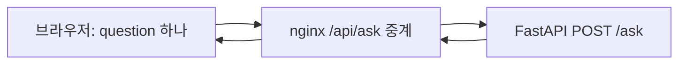

# 프런트엔드 설계와 구현 순서

- 기준일: 2026-10-14
- 상태: 사용자와 검토한 프런트엔드 구현 방향을 문서화한 설계. `web/` 기본 프로젝트는 생성되어 있다. 질문 기능·정적 내보내기·nginx 연결·운영 배포의 완료는 확인하지 않았다.
- 서비스 정책: [서비스 아키텍처](service-architecture.md)
- 실제 API 계약: [스키마](../app/schemas.py), [질문 라우터](../app/routers/questions.py), [오류 처리](../app/fastapi_main.py), [API 테스트](../tests/test_api.py), [답변 응답 테스트](../tests/test_ask_response.py)
- 현재 시연 범위: [프로젝트 허브](https://www.notion.so/2bb05a3cdadc82bb813381e3fab45047)

## 목적과 범위

사내비는 회사 규정·업무 절차를 문서에 근거해 안내한다. 프런트엔드는 질문 입력, 처리 대기, 답변과 한계 안내를 이해하기 쉽게 제공한다. 신청·변경·개인 기록 조회를 실제로 처리한 것처럼 표시하지 않는다.

현재 팀 목표는 노트북에서 질문·답변 흐름을 시연하는 것이다. 첫 구현은 질문 화면과 기존 API 연결에 집중한다. 공개 소개·사용 안내의 SEO는 외부 공개 단계의 설계이며, 로그인·문서 관리·외부 배포를 현재 답변 개발의 선행 조건으로 추가하지 않는다. 인증 없는 시연은 로컬에서 공개 가능한 예시 자료로 수행한다. 사내 데이터를 외부에 제공하는 단계에서는 서버 인증·권한 검사가 필요하다.

## 기술 선택

채택한 구성은 **Next.js App Router + TypeScript 정적 내보내기(static export) + nginx + FastAPI**다. 배포 컴퓨터에는 nginx와 FastAPI를 실행하고, 프런트 HTML·CSS·JavaScript는 개발 컴퓨터 또는 CI에서 빌드해 전달한다. 운영용 Next.js Node 서버는 두지 않는다. 공개 소개 페이지와 대화형 질문 화면을 하나의 프로젝트에서 관리하고, 기존 FastAPI를 질문 처리 서버로 유지한다.

| 선택 | 적합한 조건 | 판단 |
|---|---|---|
| Next.js + TypeScript | 공개 페이지와 앱을 함께 운영 | 채택. HTML·메타데이터는 빌드 시 생성하고 API 중계는 nginx가 담당 |
| React + Vite | 공개 검색 유입 없이 내부 앱만 운영 | 내부 전용으로 범위가 확정되면 단순한 대안 |
| Astro | 소개·문서 등 콘텐츠가 주된 사이트 | 소개 사이트를 별도로 분리할 때 검토 |

Next.js를 선택해도 검색 노출이나 순위가 보장되지는 않는다. 공개할 내용의 품질과 크롤링 가능성, 성능을 따로 확인한다. 첫 구현에는 별도 전역 상태 라이브러리나 복잡한 모노레포 도구를 추가하지 않는다. 화면 상태는 React 기본 상태, HTTP 요청은 fetch, 스타일은 현재 생성된 Tailwind CSS 4와 공통 CSS 변수를 유지한다. 별도 디자인 시스템 도입은 실제 재사용 필요가 생겼을 때 검토한다.

## 화면과 검색 노출

| 화면 | 경로 | 구현 시점 | 렌더링·검색 정책 |
|---|---|---|---|
| 질문·답변 | `/chat` | 첫 시연 | 빌드 시 화면 뼈대 생성, 입력·응답 상태는 클라이언트. noindex |
| 최소 진입 화면 | `/` | 첫 시연 | 서비스 이름·지원 범위·질문 화면 링크. 개발·시연 환경은 noindex |
| 공개 서비스 소개 | `/` | 공개 단계 | 비민감 콘텐츠를 정적 생성하고 검색 허용 |
| 공개 사용 안내 | `/guide` | 공개 단계 | 정적 생성, 검색 허용 |
| 로그인 | `/login` | 인증 도입 단계 | noindex |
| 문서 관리 | `/admin/documents` | 후속 확장 | 관리자 권한 필요, noindex. 현재 구현 대상 아님 |

공개 페이지는 본문·제목·링크가 첫 HTML에 포함되도록 한다. 변경이 드문 소개·안내에 요청마다 SSR을 강제하지 않는다. Server Component라는 사실만으로 빌드 시 정적 생성되는 것은 아니므로 실제 빌드 결과를 확인한다. 입력창과 전송 버튼 등 상호작용이 필요한 부분만 Client Component로 둔다.

공개 시 페이지별 title·description·canonical, 한국어 문서 언어, 의미 있는 제목 계층, 일반 링크 탐색, Open Graph 미리보기를 제공한다. sitemap에는 공개된 정규 URL만 포함한다. 개발 주소를 canonical에 넣거나, 질문·답변·사내 문서를 메타데이터와 공유 이미지에 담지 않는다. 공개 페이지의 robots 설정과 비공개 화면의 noindex는 별도로 관리한다.

robots.txt는 크롤링 제어이며 접근 통제가 아니다. noindex도 인증을 대신하지 않는다. 크롤링을 차단하면 검색엔진이 해당 페이지의 noindex를 읽지 못할 수 있다. 사내 데이터는 인증과 서버 권한 검사로 보호하며 URL을 숨기는 것으로 보호하지 않는다.

## 디렉터리와 책임

기존 Python 디렉터리를 유지하고 `web/`에 프런트엔드를 둔다. 아래 트리는 목표 구조이며 현재 파일이 존재한다는 뜻은 아니다. guide·login·robots·sitemap은 해당 단계에 추가한다.

```text
sanaebi/
├── app/                              # 기존 FastAPI
├── docs/
├── deployment/nginx.conf             # 향후 정적 파일·API 경로 설정
└── web/
    ├── package.json
    ├── package-lock.json             # npm 잠금 파일
    ├── next.config.ts                # output: 'export' 목표
    ├── app/                          # 현재 생성된 경로 유지
    │   ├── layout.tsx                # 공통 HTML·기본 메타데이터
    │   ├── globals.css               # Tailwind·공통 스타일
    │   ├── page.tsx                  # /
    │   ├── chat/page.tsx             # 질문 화면·noindex
    │   ├── guide/page.tsx            # 공개 단계
    │   ├── login/page.tsx            # 인증 도입 단계
    │   ├── robots.ts                # 공개 단계, 정적 생성
    │   └── sitemap.ts               # 공개 단계, 정적 생성
    ├── features/question/
    │   ├── question-panel.tsx        # Client Component, 요청·화면 상태
    │   ├── question-form.tsx         # 입력·전송
    │   ├── answer-card.tsx           # 답변·오류 표시
    │   └── types.ts                  # API 경계 타입
    ├── components/ui/               # 실제 재사용되는 기본 UI
    └── lib/api/questions.ts          # 브라우저의 상대 경로 fetch
```

페이지는 화면 조합과 메타데이터, features는 질문 기능, 공통 UI는 재사용 표현, lib/api는 브라우저 API 호출을 담당한다. 질문 분류·문서 선택·LLM 호출·답변 정책과 인증·권한 검사는 FastAPI에 둔다. Next.js POST Route Handler나 서버 전용 API 중계 모듈은 이 구성에 추가하지 않는다.

정적 질문 화면 자체에는 민감한 데이터를 넣지 않는다. 화면이나 폴더 이름은 접근 통제가 아니며, 인증 도입 시 FastAPI가 모든 보호 대상 API에서 권한을 검사한다.

## 요청 흐름과 계약



브라우저는 같은 출처의 `/api/ask`를 호출한다. nginx가 `/api/` 접두사를 제거해 기존 FastAPI `/ask`로 전달한다. upstream 주소는 nginx 설정에서 관리하며 브라우저 코드에 서버 비밀을 넣지 않는다. 프런트 정적 파일과 API를 같은 출처로 제공하므로 운영 환경에서 별도 CORS 설정을 전제로 하지 않는다. API 경로에 정적 HTML fallback을 적용하지 않는다.

현재 계약은 `{"question":"휴가 신청 방법 알려줘"}` 요청과 `{"ok":true,"text":"휴가 신청 방법 알려줘","reason":""}` 응답이다. 실제 LLM 대신 임시 generate_answer가 질문을 반환한다. 분류·대화 이력·근거 목록·스트리밍은 연결되어 있지 않다. 답변 text 추출 검증과 검증 실패 시 502 응답은 코드에 추가되어 있다.

| 결과 | 중계·화면 처리 기준 |
|---|---|
| 200, ok=true | text를 답변으로 표시. echo 연결 단계임을 시연 안내에 명시 |
| 422 | 상태와 응답 형태를 보존하고 reason을 입력 오류로 표시 |
| FastAPI의 502 | 상태와 응답 형태를 보존하고 reason을 표시. 생성 원문·내부 예외를 노출하지 않음 |
| 기타 비정상 응답·연결 실패 | 안전한 오류 안내. HTML 오류 문서나 스택을 답변으로 표시하지 않음 |
| nginx 연결 실패·시간 초과 | 502·504 등 HTTP 상태를 확인하고 안전한 오류 안내. JSON 응답을 가정하지 않음 |

nginx 자체 오류는 HTML일 수 있으므로 Content-Type과 상태를 확인하고 JSON 파싱 실패도 처리한다. 일관된 JSON 오류가 필요하면 nginx 오류 응답 설정과 테스트를 별도 추가한다. FastAPI의 기존 오류 본문은 중계 과정에서 임의 교체하지 않는다. TypeScript 타입 선언만으로 런타임 응답이 검증되지는 않으므로 HTTP 상태·JSON 파싱·필드 형식을 확인한다.

질문 요청을 자동 재시도하지 않는다. 중복 호출은 향후 모델 비용과 연결된다. 처리 중 중복 전송을 막고 실패 시 입력을 보존해 사용자가 다시 시도할 수 있게 한다. 시간 초과 예산은 프런트·중계·FastAPI·모델·배포 플랫폼 한도를 함께 확인한 후 정한다. 브라우저 요청 취소가 이미 시작된 모델 실행 종료를 보장하지는 않는다.

질문·답변은 공유 캐시에 저장하지 않고 중계 응답에 `Cache-Control: no-store`를 적용하는 방향으로 구현한다. 회사 문서를 정적 생성 입력, 브라우저 번들, 분석 이벤트, URL 쿼리, 기본 로그에 포함하지 않는다. 인증 도입 후에도 사용자 데이터의 캐시 경계는 별도로 검증한다.

## 질문 화면과 상태

첫 화면은 서비스 설명, 예시 질문, 입력창·전송 버튼, 답변 영역으로 구성한다. 상태는 대기 → 요청 중 → 성공 또는 실패로 나눈다. 실패와 근거 부족은 다르며, 회사 자료가 부족하다는 정상 안내를 네트워크 오류로 표시하지 않는다.

- 입력에 label을 연결하고 공백 입력을 막는다. 한국어 IME 조합 중 Enter가 전송되지 않게 한다.
- 키보드로 입력·전송·재시도할 수 있게 하고 대기·완료 상태를 스크린리더에도 알린다.
- 답변은 우선 일반 텍스트와 줄바꿈으로 표시한다. 모델 출력을 raw HTML로 삽입하지 않는다.
- 이전 문답을 화면에 남길 수 있지만 서버 입력은 현재 질문 하나다. “이전 대화를 참조하지 않으므로 대상과 질문을 함께 적어주세요”라고 안내한다.
- CLARIFY 응답 이후에도 앞 질문을 기억한 것으로 가정하지 않는다. 사용자가 독립적으로 이해 가능한 질문을 다시 제출하도록 돕는다.
- 라벨 배지·근거 문서 링크는 현재 응답 필드에 없다. 문장을 분석해 추측하거나 임의 인용을 만들지 않는다. 구조화된 필드를 도입하려면 서버와 계약을 먼저 합의한다.
- 세션 저장·대화방 목록·파일 업로드·문서 관리·스트리밍은 후속 요구가 생겼을 때 추가한다.

## 개발 환경과 배포 방향

프런트는 npm과 package-lock.json, Python은 기존 uv와 uv.lock으로 각각 관리한다. 현재 `web/package.json`에는 Next.js 16.4.0, React 19.3.0, Tailwind CSS 4와 dev·build·start·lint 스크립트가 있다. 이는 파일 확인 결과이며 설치·실행 성공을 뜻하지 않는다. typecheck 스크립트는 아직 없다.

현재 `web/next.config.ts`에는 `cacheComponents`, `partialPrefetching` 설정이 있고 `output: 'export'`는 없다. 구현 단계에서 설치 버전의 정적 내보내기 지원 조건과 기존 설정의 호환성을 확인하고 불필요하거나 호환되지 않는 옵션을 정리한 뒤 실제 빌드로 검증한다. 이번 문서 작업에서는 해당 코드를 수정하지 않았다.

### 개발과 운영의 구분

- 개발: Next.js 개발 서버와 FastAPI를 실행한다. 동일 출처를 유지하려면 로컬 nginx의 `/`는 개발 서버로, `/api/`는 FastAPI로 중계하고 브라우저는 nginx 주소에 접속한다. 개발 서버의 갱신용 연결도 확인한다.
- 빌드: 개발 컴퓨터 또는 CI에서 의존성을 잠금 파일 기준으로 설치하고 `npm run build`로 `web/out/`을 생성한다. 빌드에는 공개 가능한 콘텐츠만 사용하고 사내 문서·답변을 포함하지 않는다.
- 운영: 완성된 `out/` 전체를 배포 컴퓨터로 전달한다. nginx는 정적 파일을 제공하고 `/api/`만 FastAPI에 중계한다. `next dev`나 `next start`를 운영 프로세스로 실행하지 않는다. 개발용 nginx 중계와 운영용 정적 파일 설정을 구분한다.
- 경로: `/chat` 직접 접근·새로고침이 생성된 HTML로 연결되도록 내보내기 경로와 nginx 규칙을 맞춘다. 존재하지 않는 경로는 404로 응답하며 모든 URL을 200인 홈 화면으로 보내지 않는다.
- 캐시·갱신: 해시가 포함된 정적 자산은 장기 캐시하고 HTML은 갱신을 확인하도록 설정한다. API 응답은 공유 캐시에서 제외한다. 배포는 HTML과 자산을 한 묶음으로 교체해 버전 혼합을 막는다.

정적 내보내기는 요청 시 SSR, POST Route Handler, Server Actions, 요청 쿠키를 읽는 서버 렌더링, ISR, Next.js rewrites를 사용하는 구성과 맞지 않는다. 기본 서버 이미지 최적화도 별도 처리해야 한다. 동적 경로는 빌드 시 생성할 경로를 알아야 한다. 공개 콘텐츠 변경은 재빌드·재배포하고 질문·답변은 브라우저에서 API로 받아 갱신한다. 서버 렌더링이 꼭 필요한 요구가 생기면 그때 Node 서버 도입 여부를 재검토한다.

### 자원 사용과 공개 범위

상주 Node 프로세스와 요청별 HTML 렌더링을 없애는 것이 이 선택의 목적이다. 실제 메모리·CPU 절감량은 측정하지 않았다. 모델을 같은 컴퓨터에서 실행한다면 모델 메모리·추론 동시성도 함께 관리해야 한다. FastAPI 프로세스 수를 늘리면 프로세스별 모델 적재가 발생할 수 있으므로 보수적인 수로 시작하고 모델 적재 방식, 대기열·동시 요청 한도, 지연 시간과 메모리를 측정한다. 외부 모델 API 사용 여부는 로컬 자원 외에도 비용·데이터 전송 조건을 보고 별도로 결정한다.

현재 노트북 시연 범위는 유지한다. 외부 공개 시에는 HTTPS와 FastAPI 인증·권한을 마련하고 백엔드 직접 접근 경계도 확인한다. 세션·쿠키·요청 보호·도메인은 후속 결정이다. 프런트의 noindex나 정적 배포만으로 사내 자료를 보호하지 않는다.

## 구현 순서와 완료 기준

| 단계 | 할 일 | 완료 근거 |
|---|---|---|
| 1. 정적 빌드 기반 | 생성된 web 확인, 버전·설정 호환성 정리, output export, 최소 진입·질문 화면 | 타입·린트·빌드 통과, out의 HTML·자산 확인 |
| 2. nginx 경로 연결 | 정적 파일 제공, /api/ 접두사 제거 후 FastAPI 중계 | /chat 새로고침·404·API 경로·캐시 헤더 확인 |
| 3. echo 연결 | 브라우저 fetch, 현재 API 호출, 대기·실패 UI | 200·422·502, 연결 실패·시간 초과·잘못된 응답·중복 전송 검증 |
| 4. 실제 답변 연결 | 서버의 분류·LLM 연결 후 기존 화면으로 결과 표시 | 답변·되묻기·미지원·자료 부족·충돌 시나리오 확인. 고정 응답 테스트와 실제 모델 결과 구분 |
| 5. 사내 데이터 접근 준비 | 서버 인증·권한, 캐시·직접 API 접근 경계 | 미인증·미허용 요청 차단 및 사용자 간 데이터 혼입 방지 확인 |
| 6. 외부 공개·SEO | 소개·안내, 메타데이터·사이트맵·공개 배포 | 최초 HTML, canonical, 사이트맵 범위, noindex, 모바일·키보드 사용 확인 |

화면의 중요한 상태는 API 대체 응답을 이용해 확인하고, 종단 테스트는 질문 입력→결과 표시와 주요 실패 흐름에 집중한다. 공개 후 Search Console 등의 URL 검사로 크롤링·색인을 별도로 확인한다. 빌드·Lighthouse 통과만으로 실제 색인이나 답변 품질을 검증했다고 하지 않는다. 이 표는 향후 완료 기준이며 이번 문서화에서 수행한 테스트 목록이 아니다.

## 참고 자료

- [Next.js Server and Client Components](https://nextjs.org/docs/app/getting-started/server-and-client-components): 화면과 상호작용 경계
- [Next.js Metadata and OG images](https://nextjs.org/docs/app/getting-started/metadata-and-og-images): 공개 페이지 메타데이터
- [Next.js Static Exports](https://nextjs.org/docs/app/guides/static-exports): 정적 내보내기·미지원 기능·nginx 배포
- [Next.js Self-hosting](https://nextjs.org/docs/app/guides/self-hosting): 자체 호스팅 고려 사항
- [Google JavaScript SEO](https://developers.google.com/search/docs/crawling-indexing/javascript/javascript-seo-basics): HTML 사전 제공과 크롤링
- [Google noindex](https://developers.google.com/search/docs/crawling-indexing/block-indexing): 색인 제외와 크롤링의 차이
- [Vite 안내](https://vite.dev/guide/), [Astro 설계 방향](https://docs.astro.build/en/concepts/why-astro/): 대안 선택 근거
