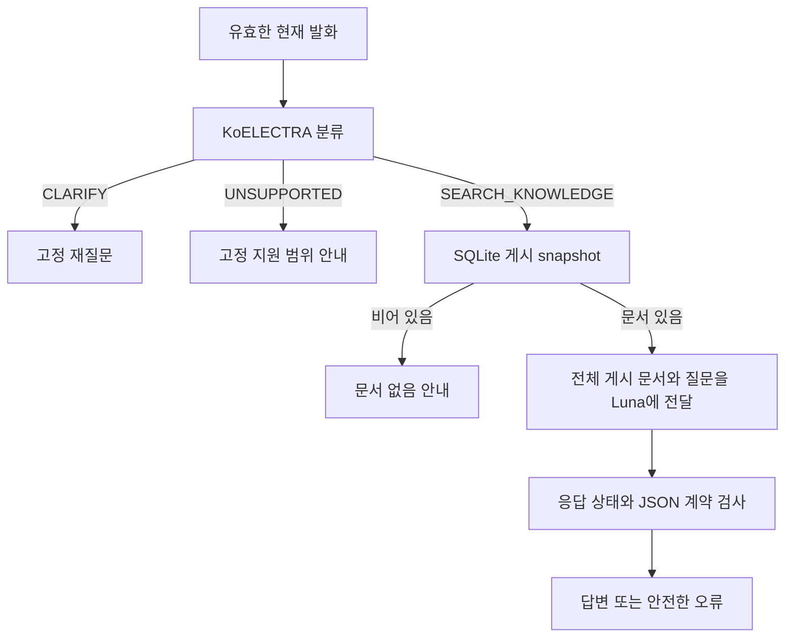

# 현재 설계와 실행 감사

## 조사 기준

- checkout: `/home/jake/workspace/projects/sanaebi`
- branch: `feat/classifier-augmentation-20261015`
- HEAD: `aeec092d184dfffe0e626a6be5762196a699623c`
- 실제 서버 프로세스의 모델을 새로 호출한 감사는 아니다. 현재 체크아웃의 코드·설정·저장 실험을 확인했다.
- 웹 관련 기존 미커밋 변경은 이번 조사 대상에서 제외했다.

## 기준 위치와 확인 내용

| 기준 위치 | 확인 내용 |
|---|---|
| `docs/label-taxonomy.md` | 현재 발화 하나만 입력. 명확성·업무 범위·순수 조회/실행을 3개 경로로 나눔 |
| `app/questions/service.py` | CLARIFY/UNSUPPORTED는 고정 문구로 반환; 문서를 읽지 않고 생성기 미호출 |
| `generation/prompts.py` | 회사 문서 기반 답변, 근거 부족 안내, 실제 조회/실행 불가 지침 |
| `generation/profiles.py` | `examples_answer_scope_v1` 추가 규칙·대조 예시·부분 답변 안내 |
| `docs/service-architecture.md` | 세 라벨의 의미와 경계가 프로젝트 자체 결정임을 명시 |
| `classification/reports/2026-10-15-routing-augmentation/README.md` | 후보 학습 결과, 승격 보류, 실제 생성 미실행 |

연결된 Notion [서비스 설계](https://www.notion.so/3f805a3cdadc81d7b909fc71ed78381b), [라벨 기준](https://www.notion.so/3f805a3cdadc813485e4d94773974acc)도 읽어 같은 계약을 확인했다. 이들은 현재 문서화된 계약의 근거이며 사용자가 처음 의도한 개념과 일치한다는 증거는 아니다.

## 실제 데이터 흐름

현재 전체 게시 문서를 전달하는 방식이며 벡터 검색을 실행하는 구조로 설명하면 안 된다. `tmp/rag-integration-review-2026-10-15/report.md`의 검색 통합안은 별도 제안이다. 그 제안이 기존 분류기를 보존한 것은 작업 범위에 따른 선택이며 사전 차단의 품질 우위를 입증하지 않는다.

분류 입력에 문서·문서 제목·게시 상태가 없으므로 실제 답변 근거를 판정할 수 없다. 같은 질문도 문서 게시 전후에 답변 가능성이 달라지지만 분류기가 보는 입력은 같다. 따라서 ‘답변 가능성’을 학습 라벨 이름으로 쓰려면 무엇을 알고 판정하는지 먼저 정의해야 한다.

## 네 가지 다른 문제

1. **모델 일반화 문제:** 회사 연차 안내를 거절하는 것은 기존 v1 계약으로도 오류다. 보강으로 일부 표현은 개선됐지만 존댓말 변형은 남았다.
2. **계약 선택 문제:** 김치 질문을 사전에 거절할지, 문서 기반 생성기가 제한할지는 제품 설계 선택이다. v1 점수를 높이는 것만으로 선택의 우열을 알 수 없다.
3. **정보 부족과 대화 문제:** ‘이 제도’의 대상이 없으면 되물어야 하지만 현재 시스템은 이전 대화를 입력하지 않는다. 대화형 화면이 자동으로 다중 턴 의미 해석을 보장하지 않는다.
4. **운영 오류:** 개인정보 사고 질문의 502와 API 키 전달 문제는 분류 책임과 별개였다. `.env` 전달 변경과 후보 학습 결과를 하나의 원인 해결로 합치지 않는다.

## 과거 결과의 정확한 의미

| 자료 | 기존→후보 | 해석 범위 |
|---|---|---|
| 고정 validation | 131/133→131/133 | 합성 기존 분할; 오류 문항이 동일하다는 뜻은 아님 |
| 개발 회귀 | 29/48→40/48 | 기존 v1 정답 라벨 기준 |
| 새 의도 그룹 평가 | 20/30→29/30 | 당시 미열람, 이제는 노출된 AI 작성 자료 |
| 표현 비교 | 18/24→24/24 | 회귀와 중복되므로 합산하지 않음 |

후보는 사전 기준 42/48 및 CLARIFY 6/8에 미달하여 배포하지 않았다. 그 결정을 이번 조사로 소급 취소하지 않는다. 이후 계약을 바꾸면 새 버전 평가를 별도로 작성한다.

## 기존 참고 자료의 범위

- `tmp/langchain-generation-review-2026-10-14/02-references.md`: 생성 구조·평가 참고. 해당 조사 자체가 분류기 재설계를 수행했다는 근거가 아니다.
- `tmp/prompt-reference-review-2026-10-15/02-source-catalog.md`: 회사별 프롬프트·공식 샘플. 프롬프트 개선 출처를 그대로 분류 정책의 정답으로 사용하면 범위가 달라진다.
- `tmp/classification-reimplementation-research-2026-10-14/references.md`: 분류 모델 학습·검증 방법 참고. 한국어 질문의 서비스 범위를 외부 회사가 정해 주지는 않는다.

문서 정합성 참고: `docs/service-architecture.md`에는 과거의 ‘모델·점수·시간·비용은 아직 확인되지 않았다’는 문장과 이후 구현 설명이 함께 있다. 이번 조사에서는 현재 코드와 최신 실험 보고서를 우선했다. 정식 문서 개정은 이번 tmp 조사 범위에 포함하지 않았다.
